# Champ électrique

> **Physique – S6** · Chapitre : *Champ* · Sujet : *Champ électrique*
> École européenne Jacques Delors — 2026-2027

*Document reconstitué à partir du polycopié scanné. Les ajouts manuscrits portés sur le scan sont repris ici en **note manuscrite**. Les figures ont été redessinées en SVG.*

### Comment utiliser ce document

Le cours d'origine (partie **III** et suivantes) est un **résumé** : il donne les formules, pas les explications. Tout ce qui permet de les comprendre a été ajouté :

- la **partie A** ci-dessous explique depuis le début ce qu'est une charge, une force à distance, un vecteur, un champ, une tension. Elle se lit avant le reste, sans rien connaître ;
- dans le cours, les encadrés **« En clair »** traduisent chaque formule en français courant ;
- sept figures sont **animées** (flèches qui se déplacent, vecteurs qui s'allongent, addition construite pas à pas). Elles bougent dans la version **HTML** du document, et dans n'importe quel navigateur si on ouvre le fichier SVG directement ; sur papier ou en PDF, elles s'impriment comme des images fixes lisibles ;
- la **partie E** montre où tout cela sert vraiment (imprimante à jet d'encre, photocopieuse, paratonnerre…), et la **partie G** ajoute 22 exercices corrigés adaptés d'un manuel anglais ;
- le **lexique des symboles** est en A.11, et la fin du document donne une **méthode de résolution**, les **erreurs classiques** et un **auto-test** corrigé.

---

# Partie A — Comprendre avant de calculer

## A.1. De quoi parle ce chapitre ?

> **TL;DR.** Ce chapitre répond à une seule question : comment deux objets peuvent-ils se pousser ou s'attirer **sans se toucher** ? La réponse se fait en deux temps : la **charge** mesure à quel point un objet est électrisé, et toute charge **modifie l'espace** autour d'elle en y créant un **champ**.

Tu as déjà vécu tout ça : le pull qui crépite quand on l'enlève, la règle en plastique frottée qui attire des petits bouts de papier, la petite décharge en touchant une poignée de porte, l'éclair pendant un orage. À chaque fois, deux objets agissent l'un sur l'autre **sans se toucher**.

C'est exactement le problème que ce chapitre résout. La question est :

> Comment un objet peut-il pousser ou tirer un autre objet **à distance**, à travers le vide ?

La réponse des physiciens tient en deux temps :

1. une grandeur, la **charge électrique**, mesure « à quel point » un objet est électrisé ;
2. une charge **transforme l'espace autour d'elle** : elle y crée un **champ électrique**. Toute autre charge placée dans cet espace subit alors une force.

Le champ, c'est donc l'intermédiaire : au lieu de dire « A tire sur B à distance » (ce qui est mystérieux), on dit « A crée un champ partout autour de lui, et B réagit au champ qui règne **là où B se trouve** » (ce qui est beaucoup plus facile à calculer).

> **À retenir pour les exercices**
>
> - Ne pas confondre les deux grandeurs du chapitre : la **charge** $q$ est ce que *porte* l'objet ; le **champ** $\vec{E}$ est ce que la charge *fait* à l'espace autour d'elle.
> - Le raisonnement est toujours le même, dans cet ordre : une charge source $Q$ crée un champ $\vec{E}$ → on pose une charge $q$ dedans → cette charge subit $\vec{F} = q\,\vec{E}$.
> - « À distance » n'est alors plus mystérieux : $B$ ne réagit pas à $A$, il réagit au champ qui règne **là où il se trouve**.

## A.2. La charge électrique $q$ : la « quantité d'électricité »

> **TL;DR.** D'où vient la charge (des électrons arrachés à un objet et donnés à un autre), comment on la mesure (le coulomb), pourquoi elle n'existe que par paquets indivisibles, et quels ordres de grandeur sont réalistes en électrostatique.

### Elle vient des atomes

Toute la matière est faite d'atomes, et un atome contient :

| Particule | Où ? | Charge |
|---|---|---|
| **proton** | dans le noyau | positive, $+e$ |
| **neutron** | dans le noyau | nulle (neutre) |
| **électron** | autour du noyau | négative, $-e$ |

Dans un atome normal, il y a **autant d'électrons que de protons** : les charges se compensent exactement, l'atome est **neutre**. C'est pour cela qu'un objet ordinaire ne colle à rien.

Mais les électrons extérieurs sont peu retenus : en frottant deux matériaux, on en **arrache** à l'un pour les **donner** à l'autre.

- L'objet qui **perd** des électrons devient **positif** (il lui manque du négatif).
- L'objet qui **gagne** des électrons devient **négatif**.

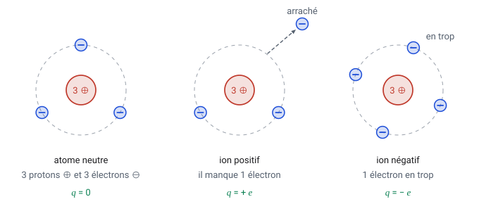

> **À retenir.** On ne « fabrique » jamais de charge : on **déplace** des électrons d'un objet à l'autre. Ce qui est positif quelque part manque ailleurs.

### Comment un objet se charge-t-il, concrètement ?

Quand tu frottes une règle en plastique sur un pull ou sur tes cheveux, le frottement multiplie les contacts entre les deux surfaces. Les électrons les moins retenus passent d'un matériau à l'autre, toujours dans le même sens pour un couple de matériaux donné.

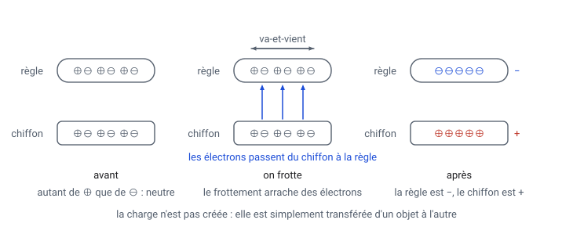

La règle en plastique **gagne** des électrons : elle devient négative. Le chiffon, qui en a perdu autant, devient positif **de la même quantité**. Expérimentalement : une tige de polythène frottée devient négative, une tige d'acétate de cellulose devient positive.

**Pourquoi seulement avec du plastique ?** Essaie de charger une tige métallique en la tenant dans la main : impossible. Il faut distinguer :

| | Conducteur (métaux, eau salée, corps humain) | Isolant (plastique, verre, air sec) |
|---|---|---|
| Électrons libres | nombreux | très peu |
| Une charge déposée dessus | **se répartit** sur tout l'objet et peut s'échapper | **reste sur place** : c'est une charge *statique* |
| Peut-on le charger par frottement ? | seulement s'il est **isolé** du sol | oui, facilement |

Ton corps et la Terre conduisent (mal, mais suffisamment) : toute charge déposée sur une tige métallique tenue à la main s'écoule immédiatement vers le sol.

> **La mise à la terre.** Relier un conducteur à la Terre, c'est lui imposer le potentiel **zéro** : les électrons en excès partent vers le sol, ou en viennent, jusqu'à ce que la tension soit nulle. C'est ce que fait la broche de terre d'une prise électrique, et c'est pour cela qu'on relie à la terre les camions-citernes avant de les remplir : sans cela, l'électricité statique accumulée par le frottement du liquide pourrait produire une étincelle.

### Son unité : le coulomb

La charge se note $q$ (ou $Q$) et se mesure en **coulombs**, symbole $\mathrm{C}$.

La plus petite charge qu'on puisse isoler est celle d'un électron, appelée **charge élémentaire** :

$$e = 1{,}60 \times 10^{-19}\ \mathrm{C}$$

Toutes les charges sont des **multiples entiers** de $e$ :

$$q = n \times e \qquad (n \text{ entier : } 1,\ 2,\ 3,\ \dots)$$

On dit que la charge est **quantifiée** : elle existe par « paquets », jamais en morceaux de paquet — comme on ne peut pas acheter un demi-centime. C'est précisément ce que l'expérience de Millikan, étudiée plus loin, a prouvé.

### Des ordres de grandeur pour s'y retrouver

| Objet | Charge approximative |
|---|---|
| un électron | $-1{,}6 \times 10^{-19}\ \mathrm{C}$ |
| un proton | $+1{,}6 \times 10^{-19}\ \mathrm{C}$ |
| un ballon frotté sur un pull | $\approx 10^{-8}\ \mathrm{C}$, soit environ 60 milliards d'électrons en trop |
| ce qui traverse une ampoule en 1 s (0,5 A) | $0{,}5\ \mathrm{C}$ |
| un éclair | de 1 à 20 C |

Le coulomb est donc une **énorme** unité quand il s'agit d'électricité statique : en pratique on manipule des nC ($10^{-9}$ C) ou des µC ($10^{-6}$ C).

> **Notation du cours.** Quand deux charges interviennent, on note souvent **$Q$** celle qui *crée* le champ (la « source ») et **$q$** celle qu'on *pose dedans* pour voir ce qui lui arrive (la « charge d'essai »). C'est une convention de lecture, pas une différence de nature.

> **À retenir pour les exercices**
>
> - $e = 1{,}60 \times 10^{-19}\ \mathrm{C}$ et $q = n\,e$ : pour passer d'un nombre d'électrons à une charge, et dans l'autre sens $n = q/e$.
> - Perdre des électrons → **positif** ; en gagner → **négatif**. Aucune charge n'est créée, elle est **transférée** : les deux objets portent des charges opposées.
> - En électrostatique on travaille en **nC** ($10^{-9}$ C) et en **µC** ($10^{-6}$ C) : convertir en coulombs **avant** tout calcul.
> - **Conducteur** : les charges circulent et s'échappent vers la terre. **Isolant** : elles restent sur place, et c'est ce qui rend la charge *statique* possible.

## A.3. Les deux règles d'or

> **TL;DR.** Qui attire qui, pourquoi les deux forces d'une paire ont toujours la **même valeur**, et pourquoi un objet chargé attire aussi un objet **neutre** — le cas dont les deux règles d'or ne parlent pas.

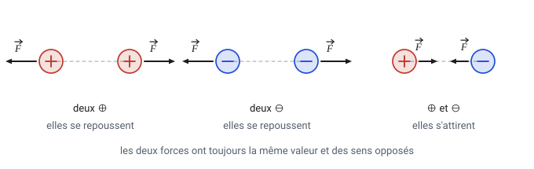

- **Mêmes signes** ($+$ et $+$, ou $-$ et $-$) : elles se **repoussent**.
- **Signes opposés** ($+$ et $-$) : elles s'**attirent**.

Deuxième règle, moins intuitive : **les deux forces ont toujours la même valeur**, même si une charge est minuscule et l'autre énorme. Si la Terre attire une pomme, la pomme attire la Terre tout aussi fort — c'est l'effet qui n'est pas le même, car la Terre est bien plus lourde. Il en va de même ici : $\vec{F}_{A/B}$ et $\vec{F}_{B/A}$ ont la même longueur et des sens opposés.

### Pourquoi un objet chargé attire-t-il un objet *neutre* ?

C'est la question qui gêne tout le monde : la règle frottée attire des petits bouts de papier, qui ne sont pourtant chargés ni $+$ ni $-$. Les deux règles d'or ne disent rien de ce cas… en apparence.

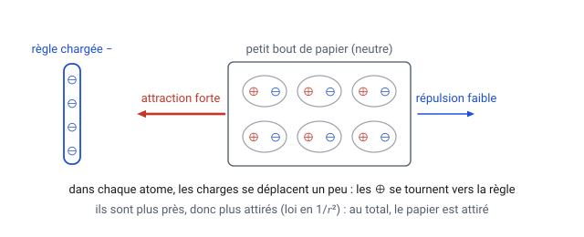

L'explication tient en deux temps :

1. Le papier est neutre **globalement**, mais il contient autant de charges $+$ que de charges $-$. Sous l'influence de la règle négative, dans chaque atome les charges se déplacent un tout petit peu : les $\oplus$ se tournent vers la règle, les $\ominus$ s'en écartent. On dit que le papier est **polarisé**.
2. Les charges $+$ sont maintenant **plus proches** de la règle que les charges $-$. Or la force varie en $1/r^{2}$ : ce qui est plus proche compte beaucoup plus. L'attraction des $+$ l'emporte donc sur la répulsion des $-$.

**Bilan : un objet chargé attire toujours un objet neutre**, quel que soit le signe de sa charge. C'est pour cette raison qu'un ballon frotté reste collé au mur.

### Charger un objet sans le toucher : l'influence

On peut aussi utiliser cet effet pour charger durablement deux conducteurs, sans jamais les toucher avec l'objet chargé.

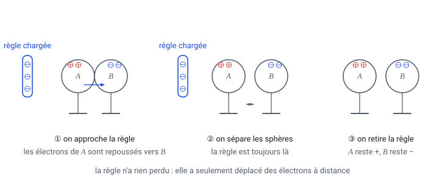

1. On approche la règle négative de deux sphères métalliques en contact, posées sur des pieds isolants : les électrons libres, repoussés, fuient vers la sphère éloignée $B$. La sphère $A$ se retrouve donc positive, $B$ négative.
2. On **sépare** les sphères, la règle toujours en place : les électrons en excès sont prisonniers de $B$.
3. On retire la règle : les charges se répartissent sur chaque sphère, mais ne peuvent plus revenir en arrière. $A$ est définitivement $+$, $B$ définitivement $-$.

> **Le point remarquable.** La règle n'a rien perdu ni rien gagné : elle a seulement *déplacé* des électrons à distance. Et les deux sphères portent des charges exactement opposées, puisqu'au départ l'ensemble était neutre.

> **À retenir pour les exercices**
>
> - **Mêmes signes → répulsion ; signes opposés → attraction.**
> - $\vec{F}_{A/B}$ et $\vec{F}_{B/A}$ ont la **même norme** et des sens opposés, même si une charge est mille fois plus grande que l'autre.
> - Un corps chargé attire **toujours** un corps neutre (polarisation, puis le $1/r^{2}$ qui avantage ce qui est le plus proche) : d'une simple attraction on ne peut donc **pas** déduire le signe d'une charge.
> - Charge par influence : deux conducteurs séparés dans le champ prennent des charges **exactement opposées**, et l'objet chargé, lui, n'a rien perdu.

## A.4. La loi de Coulomb : la force et la distance

> **TL;DR.** La formule qui donne la **valeur** de la force entre deux charges, et surtout l'effet du $r^{2}$ : doubler la distance ne divise pas la force par 2, mais par 4.

La valeur de la force entre deux charges ponctuelles vaut :

$$F = k\,\frac{\lvert Q \rvert \times \lvert q \rvert}{r^{2}}
\qquad \text{avec} \qquad k \approx 9{,}0 \times 10^{9}\ \mathrm{N\,m^{2}\,C^{-2}}\ \text{(dans le vide ou l'air)}$$

Terme par terme :

| Symbole | Ce que c'est | Effet quand il augmente |
|---|---|---|
| $Q$, $q$ | les deux charges, en C | force **plus grande** (proportionnelle) |
| $r$ | la distance entre elles, en m | force **plus petite**, et très vite |
| $k$ | une constante de la nature | — |

> **L'expérience de Coulomb (1785).** Charles Coulomb a établi cette loi en mesurant des forces minuscules avec une balance de torsion. Tu peux en refaire une version moderne : pose une tige chargée sur une balance électronique, fais le zéro, puis approche par le dessus une seconde tige chargée du même signe. La balance indique une force supplémentaire, qui augmente quand tu rapproches les tiges et quand tu les charges davantage. C'est exactement ce que dit la formule.

### Le point important : le $r^{2}$

La distance est **au carré**. Cela change tout :

| Distance entre deux charges de 1 µC | 1 cm | 2 cm | 3 cm | 10 cm |
|---|---|---|---|---|
| Force | 90 N | 22,5 N | 10 N | 0,9 N |

On double la distance → la force est divisée par $2^2 = 4$. On la triple → divisée par $9$.

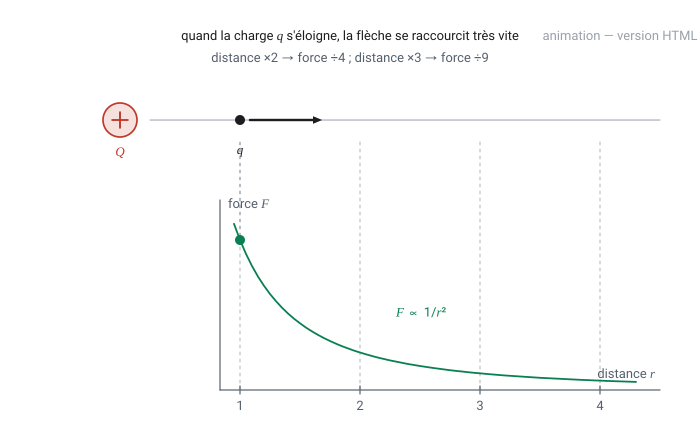

*Pourquoi un carré ?* Imagine une ampoule : sa lumière se répartit sur une sphère autour d'elle. Quand tu t'éloignes deux fois plus, la même lumière s'étale sur une sphère **quatre fois** plus grande ($S = 4\pi r^2$), donc tu en reçois quatre fois moins. L'influence électrique se dilue exactement de la même manière.

### Pour sentir la puissance de cette force

Deux charges de 1 µC (un millionième de coulomb !) distantes de 1 cm se repoussent avec 90 N : le poids d'une masse de 9 kg. À l'intérieur d'un atome, la force électrique entre le noyau et l'électron est environ $10^{39}$ fois plus intense que leur attraction gravitationnelle. La gravitation ne gagne à grande échelle que parce que les $+$ et les $-$ se compensent presque parfaitement partout.

$$\underbrace{F = k\,\frac{Qq}{r^{2}}}_{\text{Coulomb, électricité}}
\qquad\text{à comparer à}\qquad
\underbrace{F = G\,\frac{M m}{r^{2}}}_{\text{Newton, gravitation}}$$

Même forme mathématique, deux différences : la gravitation **attire toujours** (il n'existe pas de masse négative), et elle est incomparablement plus faible.

> **Exemple résolu 1 — une force de Coulomb.**
> *Deux petites sphères portent $Q_1 = +3{,}0\ \mathrm{nC}$ et $Q_2 = -5{,}0\ \mathrm{nC}$, distantes de $4{,}0\ \mathrm{cm}$. Quelle force subissent-elles ?*
> Formule en lettres puis valeurs, en unités SI :
> $$F = k\,\frac{\lvert Q_1 \rvert \lvert Q_2 \rvert}{r^{2}} = \frac{9{,}0 \times 10^{9} \times 3{,}0 \times 10^{-9} \times 5{,}0 \times 10^{-9}}{(4{,}0 \times 10^{-2})^{2}} = \frac{1{,}35 \times 10^{-7}}{1{,}6 \times 10^{-3}} \approx 8{,}4 \times 10^{-5}\ \mathrm{N}$$
> Les charges sont de signes opposés : les deux forces sont **attractives**, dirigées l'une vers l'autre, et valent chacune $8{,}4 \times 10^{-5}$ N.
> *(Remarque : une sphère chargée agit comme si toute sa charge était concentrée en son centre — à condition qu'elle ne soit pas trop près de l'autre.)*

> **À retenir pour les exercices**
>
> - $F = k\,\dfrac{\lvert Q \rvert\,\lvert q \rvert}{r^{2}}$ avec $k \approx 9{,}0 \times 10^{9}\ \mathrm{N\,m^{2}\,C^{-2}}$ dans le vide **et dans l'air**.
> - $r$ se compte en **mètres**, entre les centres, et il est **au carré** : $(2 \times 10^{-2})^{2} = 4 \times 10^{-4}$.
> - Technique du rapport, qui évite tout calcul : distance $\times n$ → force $\div n^{2}$ ; une charge $\times n$ → force $\times n$.
> - Même forme que la gravitation $F = G\,Mm/r^{2}$, avec deux différences : l'électricité peut **repousser**, et elle est incomparablement plus intense.

## A.5. Un vecteur, mode d'emploi

> **TL;DR.** La différence entre $\vec{F}$ (une flèche) et $F$ (un nombre positif), à quoi sert le vecteur unitaire $\vec{u}$ des formules du cours, et les deux façons d'additionner des vecteurs.

Dire « la force vaut 90 N » ne suffit pas : il faut savoir **vers où** elle pousse. C'est le rôle du **vecteur**, noté avec une flèche : $\vec{F}$.

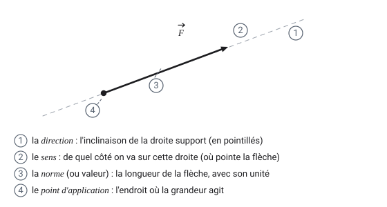

Deux notations à ne jamais confondre :

| Écriture | Nom | Ce que c'est |
|---|---|---|
| $\vec{F}$ | le vecteur force | une flèche : valeur **+ orientation** |
| $F$ ou $\lVert \vec{F} \rVert$ | la norme de $\vec{F}$ | un nombre **toujours positif**, avec son unité |

### Le vecteur unitaire $\vec{u}$

Dans les formules du cours apparaît $\vec{u}$ : c'est une flèche de **longueur 1**, sans unité, qui ne sert **qu'à indiquer une direction et un sens**. Ici, $\vec{u}$ pointe toujours **de la charge source $Q$ vers la charge $q$**.

Son intérêt : il permet d'écrire attraction et répulsion avec **une seule formule**, grâce au signe du produit $Q \cdot q$ :

$$\vec{F_{el}} = k\,\frac{Q \cdot q}{r^{2}}\ \vec{u}$$

- Si $Q \cdot q > 0$ (mêmes signes) : le nombre devant $\vec{u}$ est **positif**, donc $\vec{F}$ est **dans le sens de $\vec{u}$**, c'est-à-dire en s'éloignant de $Q$ → **répulsion**.
- Si $Q \cdot q < 0$ (signes opposés) : le nombre est **négatif**, donc $\vec{F}$ est **à l'opposé de $\vec{u}$**, il pointe vers $Q$ → **attraction**.

> **Astuce de lecture.** Multiplier un vecteur par un nombre négatif, cela veut simplement dire : *garder la même droite, retourner la flèche*.

### Additionner des vecteurs

Deux méthodes, qui donnent évidemment le même résultat :

1. **Graphiquement** : on met les flèches bout à bout, ou on construit le parallélogramme ; la diagonale est la somme.
2. **Par le calcul** (la plus sûre) : on additionne les **coordonnées** séparément.

$$\vec{E_1} \begin{pmatrix} x_1 \\ y_1 \end{pmatrix}
+ \vec{E_2} \begin{pmatrix} x_2 \\ y_2 \end{pmatrix}
= \vec{E} \begin{pmatrix} x_1 + x_2 \\ y_1 + y_2 \end{pmatrix}
\qquad\text{puis}\qquad
\lVert \vec{E} \rVert = \sqrt{x^{2} + y^{2}}$$

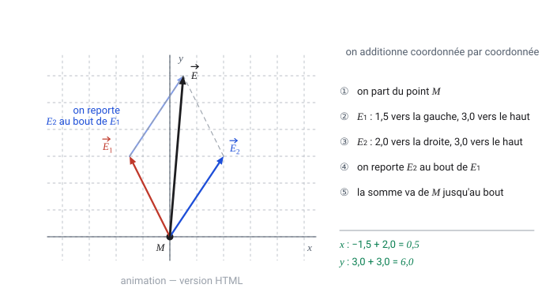

Cette dernière racine, c'est simplement **Pythagore** : la longueur de la flèche à partir de ses deux côtés horizontal et vertical.

> **À retenir pour les exercices**
>
> - Une **norme** ($F$, $E$) est **toujours positive** : c'est le vecteur qui porte le sens, jamais le nombre.
> - $\vec{u}$ va **de la source $Q$ vers la charge $q$**. Le signe du produit $Q \cdot q$ fait tout le travail : positif → répulsion (sens de $\vec{u}$), négatif → attraction (sens opposé).
> - Addition sûre : on additionne **coordonnée par coordonnée**, puis Pythagore $\lVert \vec{E} \rVert = \sqrt{E_x^{2} + E_y^{2}}$.
> - Ne **jamais** additionner deux normes directement : $3$ et $4$ perpendiculaires donnent $5$, opposés donnent $1$.

---

## A.6. Qu'est-ce qu'un « champ » ?

> **TL;DR.** Ce que les physiciens appellent un **champ** : une grandeur qui possède une valeur en chaque point de l'espace. Le champ électrique se lit comme une carte des vents, et la pesanteur en donne l'analogie exacte.

En physique, un **champ**, c'est une grandeur qui possède une valeur **en chaque point de l'espace**.

Tu en connais déjà :

| Exemple | En chaque point, on connaît… | Type |
|---|---|---|
| carte des températures | un nombre (18 °C, 22 °C…) | champ **scalaire** (un nombre) |
| carte des vents | une flèche (direction + vitesse) | champ **vectoriel** (une flèche) |
| champ de pesanteur $\vec{g}$ | une flèche vers le bas, 9,81 N/kg | champ **vectoriel** |

Le **champ électrique** $\vec{E}$ est du même type que la carte des vents : en chaque point de l'espace, il y a une flèche.

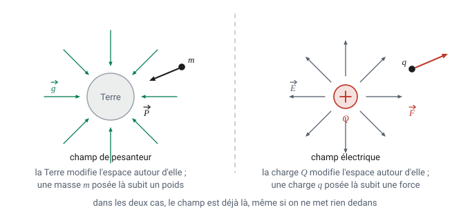

L'analogie avec la pesanteur est la plus utile de tout le chapitre :

| Gravitation | Électricité |
|---|---|
| une **masse** $M$ crée un champ de pesanteur $\vec{g}$ | une **charge** $Q$ crée un champ électrique $\vec{E}$ |
| une masse $m$ posée dedans subit $\vec{P} = m\,\vec{g}$ | une charge $q$ posée dedans subit $\vec{F} = q\,\vec{E}$ |
| $g = 9{,}81\ \mathrm{N\,kg^{-1}}$ : force par kilogramme | $E$ en $\mathrm{N\,C^{-1}}$ : force par coulomb |
| la force dépend de $m$, pas $\vec{g}$ | la force dépend de $q$, pas $\vec{E}$ |

> **L'idée clé.** Le champ **existe déjà**, même si on ne pose rien dedans. Le champ de pesanteur d'une salle de classe existe même quand personne ne saute. De la même façon, une charge $Q$ seule dans le vide a déjà un champ électrique tout autour d'elle ; la charge $q$ ne sert qu'à le *révéler*.

> **À retenir pour les exercices**
>
> - $\vec{P} = m\,\vec{g}$ ↔ $\vec{F} = q\,\vec{E}$ : la charge joue exactement le rôle de la masse. Toute question sur $\vec{E}$ peut se reformuler sur $\vec{g}$.
> - Le champ **existe sans la charge d'essai** : $q$ ne fait que le révéler. Retirer $q$ ne supprime pas $\vec{E}$.
> - Champ **scalaire** = un nombre en chaque point (température, potentiel $V$) ; champ **vectoriel** = une flèche ($\vec{E}$, $\vec{g}$).

## A.7. Pourquoi diviser par $q$ ?

> **TL;DR.** Pourquoi on définit le champ comme une force **par unité de charge** : c'est le seul moyen d'obtenir une grandeur qui décrive l'espace et non la charge qu'on y a posée. Et pourquoi $E$ se mesure aussi bien en N/C qu'en V/m.

Si on mesure la force sur une charge d'essai, le résultat dépend de la charge choisie : prends une charge deux fois plus grande, tu obtiens une force deux fois plus grande. Ce n'est donc pas une bonne description de **l'espace lui-même**.

La solution : **diviser la force par la charge d'essai**. Ce rapport, lui, ne dépend plus du tout de ce qu'on a posé :

$$E = \frac{F_{el}}{\lvert q \rvert}
\qquad \text{(force par unité de charge)}$$

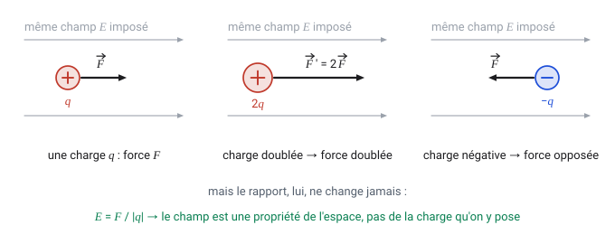


Et le sens ? Par définition $\vec{F} = q\,\vec{E}$, donc :

- si $q > 0$ : $\vec{F}$ a **le même sens** que $\vec{E}$ ;
- si $q < 0$ : $\vec{F}$ a le **sens opposé** à $\vec{E}$ (c'est le cas de l'électron — on s'en servira dans l'exercice de Thomson).

### Les deux unités du champ

$$\left[\,E\,\right] = \frac{\mathrm{N}}{\mathrm{C}} = \mathrm{N\,C^{-1}}
\qquad\text{et aussi}\qquad
\mathrm{V\,m^{-1}}$$

Les deux écritures sont **identiques** : $1\ \mathrm{N\,C^{-1}} = 1\ \mathrm{V\,m^{-1}}$. La première vient de $E = F/q$ (force par charge), la seconde de $E = U/d$ (tension par mètre). Les deux formules décrivent le même champ, vu sous deux angles.

Quelques ordres de grandeur :

| Situation | Champ $E$ |
|---|---|
| entre deux plaques de TP (200 V sur 10 cm) | $2 \times 10^{3}\ \mathrm{V\,m^{-1}}$ |
| sous un nuage d'orage, près du sol | $\approx 10^{4}\ \mathrm{V\,m^{-1}}$ |
| seuil de claquage de l'air sec (l'étincelle jaillit) | $3 \times 10^{6}\ \mathrm{V\,m^{-1}}$ |
| à $10^{-10}\ \mathrm{m}$ d'un électron (dans un atome) | $\approx 10^{11}\ \mathrm{V\,m^{-1}}$ |

> **À retenir pour les exercices**
>
> - $E = \dfrac{F_{el}}{\lvert q \rvert}$ et $\vec{F} = q\,\vec{E}$ : deux écritures de la même relation, à utiliser selon ce que donne l'énoncé.
> - $1\ \mathrm{N\,C^{-1}} = 1\ \mathrm{V\,m^{-1}}$ : les deux unités sont **identiques**, on choisit celle du contexte.
> - Sens : $q > 0$ → $\vec{F}$ dans le sens de $\vec{E}$ ; $q < 0$ (un électron) → sens **opposé**.
> - Repères utiles : plaques de TP $\sim 10^{3}$ V/m, nuage d'orage $\sim 10^{4}$ V/m, claquage de l'air $3 \times 10^{6}$ V/m.

## A.8. Les lignes de champ : la carte du champ

> **TL;DR.** Comment représenter un champ sans dessiner une flèche en chaque point, et comment **lire** une carte de lignes de champ. Les cinq règles ci-dessous sont celles qui tombent en contrôle.

Dessiner une flèche en chaque point serait illisible. On trace donc des **lignes de champ** : des courbes qui suivent les flèches.

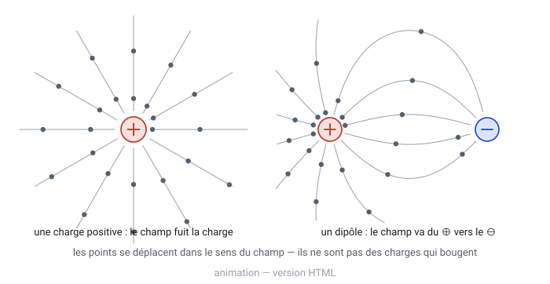

Règles de lecture, toutes utiles en contrôle :

1. en chaque point, le vecteur $\vec{E}$ est **tangent** à la ligne (il la suit) ;
2. les lignes **partent des charges positives** et **arrivent sur les charges négatives** (du $\oplus$ vers le $\ominus$) ;
3. elles ne se **croisent jamais** — sinon le champ aurait deux directions au même endroit, ce qui n'a pas de sens ;
4. là où les lignes sont **serrées**, le champ est **intense** ; là où elles sont espacées, il est faible ;
5. elles sont **perpendiculaires** à la surface d'un conducteur chargé (et aux équipotentielles, voir A.9).

> **Peut-on voir un champ ?** Presque. On saupoudre des grains de semoule sur de l'huile de ricin, puis on plonge deux électrodes reliées à une haute tension (quelques kV) dans l'huile. Les grains, polarisés par le champ (même mécanisme qu'en A.3), s'orientent et s'alignent bout à bout : ils dessinent les lignes de champ. Avec deux plaques parallèles on obtient des lignes droites et régulièrement espacées ; avec une pointe et un anneau, un champ radial. C'est l'équivalent électrique de la limaille de fer autour d'un aimant.

> **À retenir pour les exercices**
>
> - $\vec{E}$ est **tangent** à la ligne de champ en chaque point.
> - Les lignes **sortent** des charges $\oplus$ et **entrent** dans les charges $\ominus$.
> - Elles ne se **croisent jamais** — sinon le champ aurait deux sens au même endroit.
> - Lignes **serrées** → champ **intense** ; lignes espacées → champ faible.
> - Elles sont **perpendiculaires** à la surface d'un conducteur et aux équipotentielles.

## A.9. Potentiel $V$, tension $U$ : l'analogie de l'altitude

> **TL;DR.** La partie la plus abstraite du chapitre, rendue simple par une seule analogie : le **potentiel** est une altitude, la **tension** une dénivelée, le **champ** une pente. Tout le reste en découle, y compris $E = U/d$ et $W = q\,\Delta V$.

C'est la partie la plus abstraite du chapitre, et l'analogie du relief la rend simple.

| Relief, randonnée | Électricité |
|---|---|
| l'**altitude** d'un point (en m) | le **potentiel** $V$ d'un point (en volts) |
| la **dénivelée** entre deux points | la **tension** $U = V_A - V_B$ (en volts) |
| les **courbes de niveau** (même altitude) | les **surfaces équipotentielles** (même potentiel) |
| la **pente** (forte si les courbes sont serrées) | le **champ** $E$ (fort si les équipotentielles sont serrées) |
| une bille roule vers le **bas** | une charge $+$ est poussée vers les **potentiels bas** |

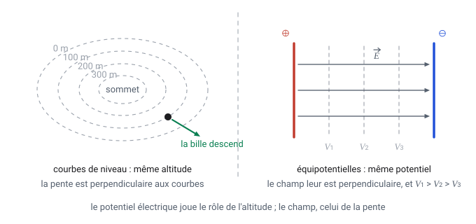

Deux conséquences qu'il faut savoir énoncer :

- **le champ est toujours perpendiculaire aux équipotentielles** (la ligne de plus grande pente coupe les courbes de niveau à angle droit) ;
- **le champ pointe vers les potentiels décroissants** (ça descend), donc de la plaque $\oplus$ vers la plaque $\ominus$.

> **Et le volt, au fait ?** $1\ \mathrm{V} = 1\ \mathrm{J\,C^{-1}}$ : une tension de 1 volt signifie qu'un coulomb de charge gagne (ou perd) 1 joule d'énergie en passant d'un point à l'autre. Une pile de 4,5 V donne donc 4,5 J à chaque coulomb qui la traverse.

### Le potentiel créé par une charge ponctuelle

On peut donner au potentiel une valeur *absolue*, et pas seulement des différences. Par convention, on décide que le potentiel vaut **zéro à l'infini** — c'est-à-dire très loin de toute charge. Alors :

> Le potentiel $V$ en un point est le travail qu'il faut fournir pour amener **un coulomb** de charge positive depuis l'infini jusqu'à ce point.

Autour d'une charge ponctuelle $Q$, à la distance $r$ :

$$\boxed{\;V = k\,\frac{Q}{r}\;}
\qquad\text{à comparer à}\qquad
E = k\,\frac{\lvert Q \rvert}{r^{2}}$$

Trois remarques qui évitent bien des erreurs :

- Le potentiel décroît en $1/r$, le champ en $1/r^{2}$ : **ce ne sont pas les mêmes courbes**.
- $V$ est un **scalaire** (un simple nombre, avec un signe), alors que $\vec{E}$ est un vecteur. Pour additionner les potentiels de plusieurs charges, on additionne donc de **simples nombres** — c'est bien plus facile que d'additionner des vecteurs.
- Le signe de $V$ est celui de $Q$ : positif autour d'une charge positive, **négatif** autour d'une charge négative. Pourquoi ? Pour approcher une charge $+$ d'une charge $+$, il faut pousser : on fournit de l'énergie, donc $V>0$. Pour l'approcher d'une charge $-$, elle est attirée : c'est elle qui fournit le travail, donc $V<0$.

### Travail et énergie : $W = q\,\Delta V$

C'est la formule qui relie l'électricité à l'énergie, et elle découle directement de la définition du volt :

$$\Delta W = q \times \Delta V$$

Si une charge de 2 C passe d'un point à 50 V à un point à 35 V, elle perd $2 \times 15 = 30$ J, convertis en énergie cinétique (ou en chaleur, dans un conducteur).

> **Conséquence utile.** Si une charge se déplace **le long d'une équipotentielle**, $\Delta V = 0$, donc $W = 0$ : *aucun travail n'est nécessaire*. Exactement comme marcher à flanc de colline en suivant une courbe de niveau.

### Un conducteur chargé : la charge est en surface, le champ est nul dedans

Pose une charge $Q$ sur une sphère métallique isolée. Les charges, qui se repoussent, s'écartent le plus possible : elles se répartissent **uniformément sur la surface**. Il en résulte deux faits que les exercices adorent :

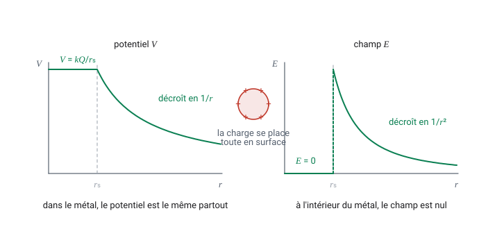

- **À l'intérieur du métal, le champ électrique est nul** et le potentiel est le même partout. (S'il ne l'était pas, les électrons libres se déplaceraient jusqu'à ce que ce soit vrai.) C'est le principe de la *cage de Faraday* : dans une voiture ou un avion frappé par la foudre, on est protégé.
- **À l'extérieur, tout se passe comme si toute la charge était concentrée au centre** : on applique les formules de la charge ponctuelle, avec $r$ mesuré depuis le centre.

Le lien entre les deux graphiques n'est pas un hasard : le champ est la **pente** du potentiel,

$$E = -\frac{\Delta V}{\Delta r}$$

Le signe moins dit simplement que le champ est dirigé **vers les potentiels décroissants** — c'est la version mathématique de « ça descend » (A.9). Là où le potentiel est constant (dans le métal), la pente est nulle, donc $E = 0$.

> **Exemple résolu 2 — le dôme d'un générateur de Van de Graaff.**
> *Le dôme est une sphère de rayon $20\ \mathrm{cm}$ portant une charge de $15\ \mathrm{µC}$. Quel est le champ à sa surface ?*
> $$E = k\,\frac{\lvert Q \rvert}{r^{2}} = \frac{9{,}0 \times 10^{9} \times 15 \times 10^{-6}}{(0{,}20)^{2}} = \frac{1{,}35 \times 10^{5}}{4{,}0 \times 10^{-2}} \approx 3{,}4 \times 10^{6}\ \mathrm{V\,m^{-1}}$$
> C'est au-dessus du seuil de claquage de l'air sec ($3{,}0 \times 10^{6}\ \mathrm{V\,m^{-1}}$) : des étincelles vont jaillir.
>
> **Exemple résolu 3 — le potentiel d'une sphère.**
> *Une sphère conductrice isolée de rayon $12\ \mathrm{cm}$ reçoit une charge de $0{,}16\ \mathrm{nC}$. Quel est son potentiel ?*
> $$V = k\,\frac{Q}{r} = \frac{9{,}0 \times 10^{9} \times 0{,}16 \times 10^{-9}}{0{,}12} = \frac{1{,}44}{0{,}12} = 12\ \mathrm{V}$$
> Tout le métal est à 12 V, surface comprise.

### Entre deux plaques : $E = U/d$

Deux plaques parallèles reliées à un générateur forment un **condensateur plan**. Entre elles, le champ est **uniforme** : même direction, même sens, même valeur partout.

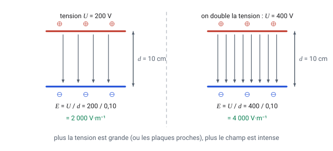

$$E = \frac{U}{d}$$

Cela se lit comme une pente : « on descend de $U$ volts en parcourant $d$ mètres ». Donc :

- on **double la tension** $U$ → le champ **double** ;
- on **rapproche les plaques** (on divise $d$ par 2) → le champ **double** aussi.

C'est pour cela qu'un petit condensateur avec des plaques très proches peut produire un champ énorme avec une pile ordinaire.

> **À retenir pour les exercices**
>
> - $V = k\,\dfrac{Q}{r}$ (zéro à l'infini) : un **nombre** avec un signe, donc les potentiels de plusieurs charges s'additionnent **sans vecteurs**. $V$ décroît en $1/r$, $E$ en $1/r^{2}$ : ce ne sont pas les mêmes courbes.
> - $U = V_A - V_B$ est une **différence** ; $W = q\,\Delta V$ donne l'énergie échangée. Le long d'une équipotentielle, $\Delta V = 0$ donc $W = 0$.
> - $E = \dfrac{U}{d}$ entre deux plaques, et plus généralement $E = -\dfrac{\Delta V}{\Delta r}$ : le champ est la **pente** du potentiel et pointe vers les potentiels **décroissants**.
> - Conducteur chargé : $E = 0$ à l'intérieur et $V$ y est constant ; à l'extérieur, tout se passe comme si la charge était **au centre**.
> - $1\ \mathrm{V} = 1\ \mathrm{J\,C^{-1}}$ : un coulomb qui passe sous 1 volt échange 1 joule.

## A.10. Unités, préfixes et pièges de calcul

> **TL;DR.** La liste de contrôle à passer **avant** d'appuyer sur la calculatrice : les préfixes, les conversions, et le piège du carré sur les puissances de 10 — l'erreur numéro un des copies.

Avant tout calcul, **tout convertir dans les unités du Système International** : mètre, seconde, kilogramme, coulomb, volt.

| Préfixe | Symbole | Multiplie par | Exemple |
|---|---|---|---|
| nano | n | $10^{-9}$ | $5\ \mathrm{nC} = 5 \times 10^{-9}\ \mathrm{C}$ |
| micro | µ | $10^{-6}$ | $2\ \mathrm{µC} = 2 \times 10^{-6}\ \mathrm{C}$ |
| milli | m | $10^{-3}$ | $2{,}76\ \mathrm{mm} = 2{,}76 \times 10^{-3}\ \mathrm{m}$ |
| centi | c | $10^{-2}$ | $5\ \mathrm{cm} = 5 \times 10^{-2}\ \mathrm{m} = 0{,}05\ \mathrm{m}$ |
| kilo | k | $10^{3}$ | $3\ \mathrm{kV} = 3000\ \mathrm{V}$ |
| méga | M | $10^{6}$ | $1\ \mathrm{MV} = 10^{6}\ \mathrm{V}$ |

Rappels de calcul sur les puissances de 10 :

$$10^{a} \times 10^{b} = 10^{a+b}
\qquad \frac{10^{a}}{10^{b}} = 10^{a-b}
\qquad \left(10^{a}\right)^{2} = 10^{2a}$$

Exemple typique du chapitre : $\left(2 \times 10^{-2}\right)^{2} = 4 \times 10^{-4}$ — **le carré porte aussi sur la puissance de 10**, c'est l'erreur n°1 des copies.

> **À retenir pour les exercices**
>
> - Préfixes : n $= 10^{-9}$, µ $= 10^{-6}$, m $= 10^{-3}$, c $= 10^{-2}$, k $= 10^{3}$, M $= 10^{6}$.
> - Tout en unités SI avant de calculer : **m**, **kg**, **s**, **C**, **V**. Des cm ou des nC ne se mettent jamais dans une formule.
> - $(2 \times 10^{-2})^{2} = 4 \times 10^{-4}$ : le carré porte **aussi** sur la puissance de 10.
> - $10^{a} \times 10^{b} = 10^{a+b}$, $\dfrac{10^{a}}{10^{b}} = 10^{a-b}$, $\left(10^{a}\right)^{2} = 10^{2a}$.

## A.11. Lexique des symboles du chapitre

> **TL;DR.** Le tableau de tous les symboles du chapitre, avec leur unité et le piège qui va avec. C'est la page à garder ouverte pendant les exercices.

| Symbole | Nom | Unité | Remarque |
|---|---|---|---|
| $q$, $Q$ | charge électrique | C | $Q$ = source, $q$ = charge posée dans le champ |
| $e$ | charge élémentaire | C | $1{,}60 \times 10^{-19}$ C, la plus petite charge isolable |
| $n$ | nombre de charges élémentaires | — | entier, dans $q = n\,e$ |
| $r$ | distance entre deux charges | m | au **carré** dans les formules |
| $\vec{u}$ | vecteur unitaire | — | longueur 1, va de $Q$ vers $q$ |
| $\vec{F_{el}}$ | force électrostatique | N | ce que **subit** la charge |
| $\vec{E}$ | champ électrique | $\mathrm{V\,m^{-1}}$ ou $\mathrm{N\,C^{-1}}$ | ce que **crée** la charge source |
| $k$ | constante de Coulomb | $\mathrm{N\,m^{2}\,C^{-2}}$ | $\approx 9{,}0 \times 10^{9}$ dans le vide |
| $\varepsilon_{0}$ | permittivité du vide | $\mathrm{F\,m^{-1}}$ | $8{,}85 \times 10^{-12}$ |
| $\varepsilon_{r}$ | permittivité relative du milieu | — | vaut 1 dans le vide, $\approx 1$ dans l'air, 80 dans l'eau |
| $V$ | potentiel électrique | V | « l'altitude électrique » d'un point |
| $U$ | tension (différence de potentiel) | V | $U = V_A - V_B$, une **différence** |
| $d$ | distance entre les plaques | m | dans $E = U/d$ |
| $m$ | masse | kg | |
| $g$ | intensité de la pesanteur | $\mathrm{N\,kg^{-1}}$ ou $\mathrm{m\,s^{-2}}$ | $9{,}81$ |

> **À retenir pour les exercices**
>
> - $Q$ désigne la charge **source** (celle qui crée le champ), $q$ la charge **posée dedans** : c'est une convention de lecture, pas une différence de nature.
> - Unités à ne pas mélanger : $q$ en C, $F$ en N, $E$ en V/m (ou N/C), $V$ et $U$ en V, $W$ en J.
> - Constantes à connaître : $k \approx 9{,}0 \times 10^{9}$, $e = 1{,}60 \times 10^{-19}\ \mathrm{C}$, $g = 9{,}81\ \mathrm{N\,kg^{-1}}$.

---

# Partie B — Le cours

## III. Champ électrique — Résumé

### III.1. Définition du champ électrique $\vec{E}$ à partir de la force électrostatique $\vec{F_{el}}$

> **TL;DR.** La ligne de cours la plus dense du chapitre : elle contient **deux** façons de calculer la même force — $\vec{F} = q\,\vec{E}$ quand on connaît le champ, la loi de Coulomb quand on connaît la charge source. En simplifiant par $q$, on obtient le champ lui-même.

La force électrostatique $\vec{F_{el}}$ exercée par une charge $Q$ sur une charge $q$ placée dans un champ électrique $\vec{E}$ (la distance entre les deux charges est notée $r$) s'exprime :

$$\boxed{\;\vec{F_{el}} = q \times \vec{E} = k\,\frac{Q \cdot q}{r^{2}}\,\vec{u}\;}
\qquad \text{où} \quad k = \frac{1}{4\pi\varepsilon_{0}\varepsilon_{r}}$$

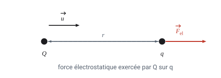

> **En clair.** Cette ligne contient **deux** façons de calculer la même force.
> La première, $\vec{F_{el}} = q\,\vec{E}$, se lit : *« la force subie par la charge $q$, c'est le champ qui règne à cet endroit, multiplié par la charge »*. C'est la plus utile quand on connaît déjà $\vec{E}$ (par exemple entre deux plaques).
> La seconde, $k\,\dfrac{Q q}{r^{2}}\,\vec{u}$, est la **loi de Coulomb** : elle sert quand on connaît la charge source $Q$ et la distance $r$.
> Le signe du produit $Q \cdot q$ s'occupe tout seul du sens : positif → répulsion (dans le sens de $\vec{u}$), négatif → attraction (sens opposé). Voir A.5.
> La constante $\varepsilon_{r}$ décrit le milieu : elle vaut 1 dans le vide, presque 1 dans l'air (on garde donc $k \approx 9{,}0 \times 10^{9}$), mais 80 dans l'eau — qui affaiblit donc 80 fois les forces électriques. C'est pourquoi le sel se dissout.

**Expression vectorielle du champ électrique $\vec{E}$ :**

$$q \times \vec{E} = k\,\frac{Q \times q}{r^{2}}\,\vec{u}
\qquad \text{donc} \qquad
\vec{E} = k\,\frac{Q}{r^{2}}\,\vec{u}$$

> **En clair.** On a simplement **simplifié par $q$** des deux côtés. Et c'est tout l'intérêt de la manœuvre : dans le résultat, **$q$ a disparu**. Le champ créé par $Q$ ne dépend plus que de $Q$ et de l'endroit où on regarde ($r$) — plus du tout de la charge qu'on y pose. C'est bien une propriété de l'espace (voir A.7).

> **À retenir pour les exercices**
>
> - $\vec{F_{el}} = q\,\vec{E} = k\,\dfrac{Q \cdot q}{r^{2}}\,\vec{u}$, et après simplification par $q$ : $\vec{E} = k\,\dfrac{Q}{r^{2}}\,\vec{u}$.
> - $k = \dfrac{1}{4\pi\varepsilon_{0}\varepsilon_{r}} \approx 9{,}0 \times 10^{9}$ dans le vide et dans l'air ($\varepsilon_{r} \approx 1$) ; dans l'eau $\varepsilon_{r} = 80$, les forces sont 80 fois plus faibles.
> - Choisir sa formule : le champ est donné (plaques, énoncé) → $\vec{F} = q\,\vec{E}$ ; la source et la distance sont données → Coulomb.
> - Dans l'expression de $\vec{E}$, la charge d'essai **a disparu** : le champ ne dépend que de $Q$ et de $r$.

### III.2. Définition de l'intensité du champ électrique

> **TL;DR.** La version « valeur » des formules : on oublie l'orientation et on ne manipule plus que des nombres positifs. Puis les deux géométries du chapitre : le champ **radial** d'une charge ponctuelle et le champ **uniforme** entre deux plaques.

$$E = \left\lVert \vec{E} \right\rVert = \frac{\left\lVert \vec{F_{el}} \right\rVert}{\lvert q \rvert} = \frac{F_{el}}{\lvert q \rvert}$$

> **En clair.** On ne parle plus ici de l'orientation, seulement de la **valeur** du champ : un nombre positif, en $\mathrm{V\,m^{-1}}$.
> Les barres $\lvert q \rvert$ sont la **valeur absolue** : on prend la charge sans son signe, car une intensité ne peut pas être négative. Une charge de $-3$ µC donne $\lvert q \rvert = 3$ µC.
> Retenir la phrase : **le champ, c'est la force par unité de charge**.

#### Champ radial (généré par une charge ponctuelle $Q$)

$$E(r) = \frac{F_{el}}{\lvert q \rvert} = k\,\frac{\lvert Q \rvert}{r^{2}}$$

> **En clair.** *Radial* vient de « rayon » : les flèches sont portées par les rayons qui partent de la charge, comme les rayons d'une roue de vélo.
> *Centrifuge* = qui **fuit** le centre. *Centripète* = qui **cherche** le centre (comme le $p$ de « pointe vers »).
> Et $E$ diminue en $1/r^{2}$ : à deux fois plus loin, le champ est quatre fois plus faible.

**Champ électrique $\vec{E}$ et ligne de champ**

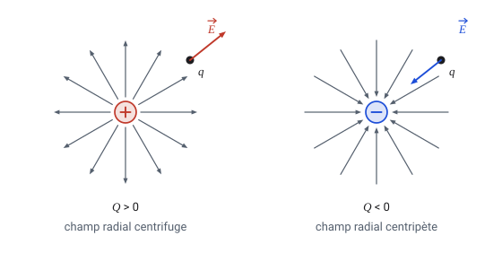

- Si $Q > 0$ : le champ électrique est **radial et centrifuge**.
- Si $Q < 0$ : le champ électrique est **radial et centripète**.

> **Note manuscrite.** Le vecteur $\vec{E}$ est **tangent** à la ligne de champ en chaque point.

> **Moyen mnémotechnique.** Les lignes **sortent** du $\oplus$ et **entrent** dans le $\ominus$ : *le plus est une source, le moins est un puits*. Attention, ce sens est celui du champ, pas celui du déplacement d'un électron — un électron, étant négatif, remonte les lignes de champ à contresens.

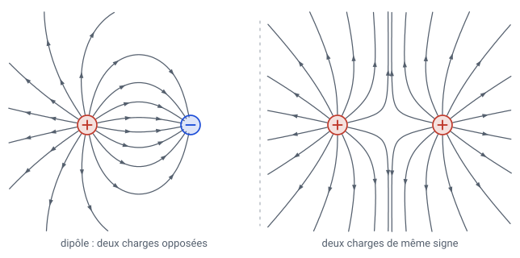

> **En clair (lecture de la figure).** À gauche, un **dipôle** : les lignes quittent le $\oplus$ et plongent dans le $\ominus$ — c'est le motif d'un aimant… électrique. À droite, deux charges de même signe : les lignes se repoussent et laissent entre les deux charges un **point neutre**, où les deux champs s'annulent exactement.

#### Champ uniforme (généré par des charges étendues. Exemple : entre deux plaques parallèles chargées)

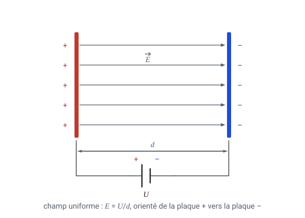

$$E = \frac{\Delta V}{d} = \frac{U}{d}$$

où $d$ est la distance séparant les deux plaques parallèles.

- La **direction** du champ est perpendiculaire aux plaques.
- Le **sens** du champ est orienté de la plaque positive vers la plaque négative.

> **Note manuscrite.** $\vec{E}$ est perpendiculaire aux plaques, dirigé de $\oplus$ vers $\ominus$.

> **En clair.** **Uniforme** veut dire : *exactement le même vecteur partout* — même direction, même sens, même valeur. Entre les plaques, peu importe où l'on se place, le champ est identique (sauf tout au bord, où les lignes débordent ; on néglige cet effet).
> $\Delta V$ (lire « delta V ») signifie « différence de potentiel » : c'est exactement la tension $U$ qu'affiche le générateur.
> Conséquence pratique : une charge placée entre les plaques subit **la même force** où qu'elle soit. C'est ce qui rend le calcul possible au niveau S6 — et c'est le dispositif utilisé par Thomson et par Millikan plus loin.

> **À retenir pour les exercices**
>
> - $E = \dfrac{F_{el}}{\lvert q \rvert}$ : la force par unité de charge. Les barres de valeur absolue garantissent un résultat positif.
> - Charge ponctuelle : $E(r) = k\,\dfrac{\lvert Q \rvert}{r^{2}}$, champ **radial**, centrifuge si $Q > 0$, centripète si $Q < 0$.
> - Deux plaques : $E = \dfrac{U}{d}$, champ **uniforme**, perpendiculaire aux plaques, dirigé de $\oplus$ vers $\ominus$ — même valeur partout entre les plaques.
> - Entre deux charges de **même signe** il existe un **point neutre** où les deux champs s'annulent.

### Superposition de champs issus de plusieurs charges ponctuelles

> **TL;DR.** Ce qui se passe quand il y a plusieurs charges : chacune crée son champ **comme si les autres n'existaient pas**, et on additionne les flèches. Aucune charge n'en gêne une autre.

En un point, le champ électrique résultant est la **somme** des champs radiaux générés par les différentes charges ponctuelles :

$$\vec{E} = \sum_{i} \vec{E_{i}} = \vec{E_{1}} + \vec{E_{2}} + \dots$$

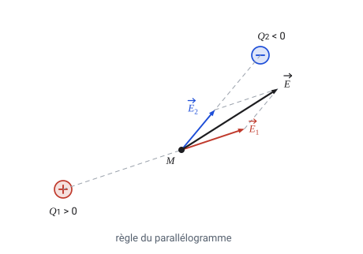

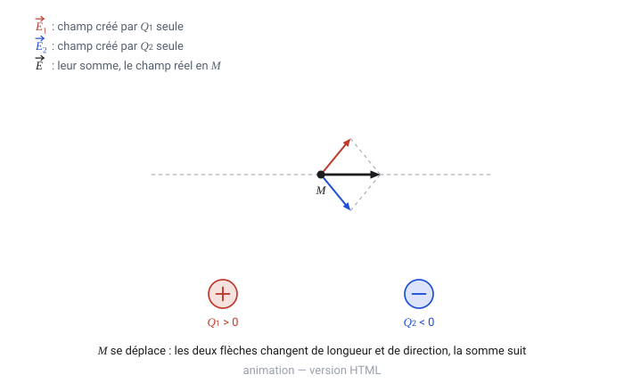

> **En clair.** Le symbole $\sum$ (sigma) veut juste dire « on additionne tout ».
> Le principe est remarquablement simple : **chaque charge crée son champ comme si les autres n'existaient pas**, et on additionne les flèches. Aucune charge ne « gêne » les autres.
> Attention : c'est une somme **de vecteurs**, pas de nombres. $3 + 4$ ne donne pas 7 ici : si les deux flèches sont perpendiculaires, la résultante vaut $\sqrt{3^2+4^2} = 5$ ; si elles sont opposées, elle vaut 1. En pratique, on additionne **coordonnée par coordonnée** (voir A.5), c'est la méthode qui ne trompe jamais.

> **À retenir pour les exercices**
>
> - $\vec{E} = \sum_{i} \vec{E_{i}}$ : une somme **de vecteurs**, jamais de normes.
> - Méthode qui ne trompe jamais : projeter chaque $\vec{E_{i}}$ sur $x$ et sur $y$, additionner coordonnée par coordonnée, puis Pythagore pour la norme.
> - Cas fréquent, deux charges sur un même axe : champs de sens opposés → on **soustrait** ; de même sens → on **ajoute**.
> - Le **point nul** est l'endroit où les contributions s'annulent exactement : il se cherche en écrivant $E_1 = E_2$ (exercices 9 et 13).

### Lignes de champ et surfaces équipotentielles

> **TL;DR.** Le lien entre la carte des flèches et la carte des potentiels : les équipotentielles sont les **courbes de niveau**, les lignes de champ les **lignes de plus grande pente**. C'est pourquoi elles se coupent à angle droit.

- Une **surface équipotentielle** correspond à l'ensemble des points de l'espace où le potentiel électrique est le même.
- Une **ligne de champ** est perpendiculaire en un point à une surface équipotentielle.
- Une **ligne de champ** donne la direction du champ en un point de l'espace.

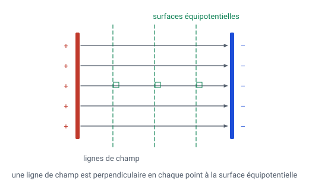

> **En clair.** Reprends l'analogie de la randonnée (A.9) : les équipotentielles sont les **courbes de niveau** de la carte, les lignes de champ sont les **lignes de plus grande pente**. Elles se coupent à angle droit, comme sur toutes les cartes IGN.
> Déplacer une charge **le long** d'une équipotentielle ne coûte aucune énergie (on marche à plat). La déplacer **le long** d'une ligne de champ, c'est monter ou descendre.
> Autour d'une charge ponctuelle, les équipotentielles sont des **sphères** centrées sur la charge ; entre deux plaques, ce sont des **plans parallèles aux plaques**.

> **À retenir pour les exercices**
>
> - Une **surface équipotentielle** réunit tous les points de même potentiel $V$ ; $\vec{E}$ lui est **perpendiculaire**.
> - Déplacer une charge **le long** d'une équipotentielle ne coûte aucun travail ($\Delta V = 0$, donc $W = 0$).
> - Autour d'une charge ponctuelle, les équipotentielles sont des **sphères** ; entre deux plaques, des **plans parallèles aux plaques**.
> - Équipotentielles **serrées** → pente forte → champ **intense** : c'est tout l'effet de pointe du paratonnerre.

---

# Partie C — Exercices

## Exercices

### Exercice 5

Une particule $A$ de charge positive est placée dans le champ électrostatique de deux particules $B$ et $C$ de charges négatives. Sur la figure 9, le champ électrostatique $\vec{E_{1}}$ dû à la particule $B$ a pour composantes horizontale et verticale $(-1{,}5\ \mathrm{V\,m^{-1}}\,;\ 3{,}0\ \mathrm{V\,m^{-1}})$ au point $A$, et le champ $\vec{E_{2}}$ dû à la particule $C$ a pour coordonnées $(2{,}0\ \mathrm{V\,m^{-1}}\,;\ 3{,}0\ \mathrm{V\,m^{-1}})$ au point $A$.

**a.** Déterminer en $A$ les coordonnées du champ électrostatique résultant $\vec{E} = \vec{E_{1}} + \vec{E_{2}}$.

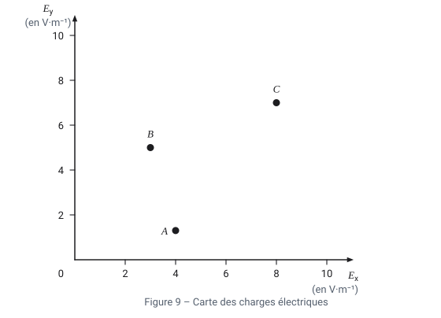

**b.** Déterminer la norme du champ résultant.

**c.** La construction est-elle en accord avec le signe des charges électriques annoncé ?

> **Avant de commencer.** « Composante horizontale et verticale » = les **coordonnées** du vecteur, c'est-à-dire de combien on avance vers la droite ($x$) et vers le haut ($y$) en suivant la flèche. Une coordonnée négative signifie simplement : vers la gauche (pour $x$) ou vers le bas (pour $y$).
> Ici $\vec{E_1}$ va **vers la gauche et vers le haut**, $\vec{E_2}$ **vers la droite et vers le haut**.
> La construction complète est animée en **A.5** : ce sont exactement ces valeurs.

#### Corrigé

**a.** On additionne composante par composante (méthode du parallélogramme) :

$$\vec{E} = \vec{E_{1}} + \vec{E_{2}} =
\begin{pmatrix} -1{,}5 \\ 3{,}0 \end{pmatrix} +
\begin{pmatrix} 2{,}0 \\ 3{,}0 \end{pmatrix} =
\begin{pmatrix} 0{,}5 \\ 6{,}0 \end{pmatrix} \ \mathrm{V\,m^{-1}}$$

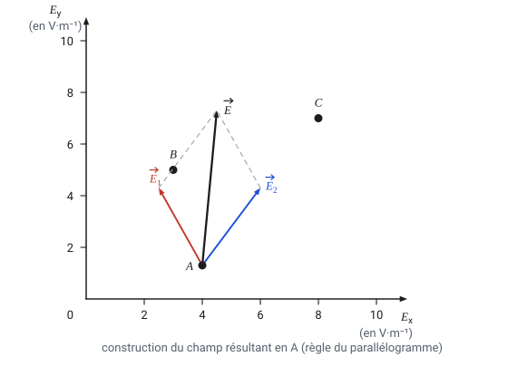

> **En clair.** Les $x$ entre eux : $-1{,}5 + 2{,}0 = +0{,}5$. Les $y$ entre eux : $3{,}0 + 3{,}0 = 6{,}0$. Les deux composantes horizontales se compensent presque ; les verticales, elles, s'ajoutent. Résultat : un champ **presque vertical, dirigé vers le haut**, ce que confirme la figure.

**b.**

$$\left\lVert \vec{E} \right\rVert = \sqrt{0{,}5^{2} + 6{,}0^{2}} \approx 6{,}02\ \mathrm{V\,m^{-1}}$$

> **En clair.** C'est Pythagore appliqué au triangle rectangle formé par la flèche et ses deux composantes : $\sqrt{0{,}25 + 36} = \sqrt{36{,}25}$.

**c.** Oui. Le champ créé en $A$ par une charge **négative** est dirigé **vers** cette charge :
$\vec{E_{1}}$ pointe de $A$ vers $B$ (vers le haut et la gauche) et $\vec{E_{2}}$ pointe de $A$ vers $C$ (vers le haut et la droite). La construction est donc bien en accord avec des charges $q_B < 0$ et $q_C < 0$.

> **En clair.** Le raisonnement à savoir refaire : une charge **négative aspire** les lignes de champ, donc en tout point le champ qu'elle crée **pointe vers elle**. Comme $B$ est en haut à gauche de $A$ et $C$ en haut à droite, les deux flèches doivent bien partir de $A$ en remontant de part et d'autre. Tout concorde.
> Remarque : la charge $A$ est positive, donc la **force** qu'elle subit a le même sens que $\vec{E}$ : elle est tirée vers le haut, entre $B$ et $C$. Logique, puisque $B$ et $C$ l'attirent toutes les deux.

### Exercice 6 — corrigé (extrait manuscrit)

*L'énoncé de cet exercice ne figure pas sur le scan ; seul le corrigé manuscrit (à l'encre rouge) a pu être transcrit.*

**a.** $q_A > 0$ et $q_B < 0$ : $\vec{F_{A/B}}$ est dirigée vers $A$ (attraction), car deux charges de signes opposés s'attirent.

$$\vec{F_{A/B}} = \underbrace{k\,\frac{q_A\,q_B}{AB^{2}}}_{<\,0}\ \vec{u_{AB}}$$

On observe que $\vec{F_{A/B}}$ et $\vec{u_{AB}}$ sont colinéaires et de sens contraire, donc $q_A q_B < 0$ ; or $q_A > 0$, donc $q_B < 0$. De même, $q_C > 0$.

> **En clair.** *Colinéaires* = portés par la même droite. La notation $\vec{F_{A/B}}$ se lit « force exercée par $A$ **sur** $B$ ».
> Le raisonnement marche **à l'envers** de d'habitude : on ne calcule rien, on **lit le dessin**. Si la flèche de la force est tournée à l'opposé de $\vec{u}$, c'est que le nombre qui multiplie $\vec{u}$ est négatif ; comme $k$ et $AB^2$ sont positifs, c'est forcément $q_A q_B$ qui est négatif. On en déduit le signe de la charge inconnue.

**b.** Des rapports de normes relevés sur la figure, $\dfrac{F_{A/B}}{F_{A/C}} \approx 4$ et $\dfrac{F_{A/B}}{F_{B/C}} \approx 2$ :

$$\frac{F_{A/B}}{F_{A/C}} = \frac{k\,\dfrac{\lvert q_A \rvert \lvert q_B \rvert}{AB^{2}}}{k\,\dfrac{\lvert q_A \rvert \lvert q_C \rvert}{AC^{2}}} = \frac{\lvert q_B \rvert}{\lvert q_C \rvert} = 4
\qquad\text{et}\qquad
\frac{\lvert q_A \rvert}{\lvert q_C \rvert} = 2
\quad \Longrightarrow \quad \lvert q_C \rvert = \tfrac{1}{2}\,\lvert q_A \rvert$$

> **En clair (la technique du rapport).** On ne connaît ni $k$, ni les distances, ni les charges… et pourtant on conclut. L'astuce : **diviser une force par l'autre**. Tout ce qui est commun aux deux expressions ($k$, $\lvert q_A \rvert$, et ici les distances supposées égales) se **simplifie**, et il ne reste que le rapport cherché. C'est un réflexe très rentable en physique : quand on demande « combien de fois plus », on fait un quotient, jamais deux calculs séparés.

---

## Exercice II — L'expérience de J. J. Thomson

Lors de ses recherches dans son laboratoire de Cambridge, Thomson conçoit un dispositif dans lequel un faisceau d'électrons est dévié lors de son passage entre deux plaques où règne un champ électrique. La mesure de la déviation du faisceau d'électrons lui permet alors de déterminer le rapport $e/m_{e}$.

L'étude suivante porte sur le mouvement d'un électron du faisceau qui pénètre entre deux plaques parallèles et horizontales $P_1$ et $P_2$, dans une zone où règne un champ électrique $\vec{E}$ supposé uniforme entre les deux plaques.

À l'instant $t = 0\ \mathrm{s}$, l'électron arrive en un point $O$ avec une vitesse horizontale $\vec{v_{0}}$. La trajectoire de l'électron dans un repère $(O, x, y)$ est fournie sur **l'annexe à rendre avec la copie**.

L'électron, de masse $m_{e}$ et de charge $q = -e$, dont le mouvement est étudié dans le référentiel terrestre supposé galiléen, est soumis à la seule force électrostatique $\vec{F_{e}}$.

> **De quoi s'agit-il ?** C'est l'expérience de 1897 qui a fait **découvrir l'électron**. Le principe tient en une phrase : on lance des électrons à grande vitesse entre deux plaques chargées, et on regarde de combien ils sont déviés. Plus la déviation est grande, plus la particule est légère pour sa charge — ce qui donne le rapport $e/m_e$.
> C'est exactement le principe du vieux téléviseur à tube cathodique, où le faisceau est dévié pour balayer l'écran.
> **Pourquoi la trajectoire est-elle une courbe ?** L'électron garde sa vitesse horizontale $\vec{v_0}$ (rien ne le freine), mais la force verticale le pousse de plus en plus vers une plaque : c'est la même situation qu'une balle lancée à l'horizontale qui tombe en **parabole**. Ici, la pesanteur est remplacée — et largement dominée — par la force électrique.
> On néglige d'ailleurs le poids : pour un électron, il est environ $10^{14}$ fois plus faible que la force électrique.

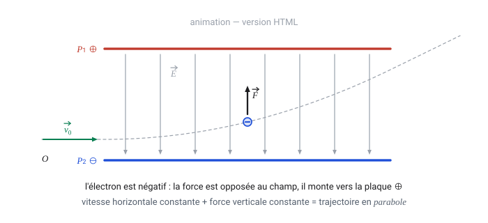

**1.1.** Sur le document de **l'annexe à rendre avec la copie**, représenter sans souci d'échelle et en justifiant les tracés :

- le vecteur force $\vec{F_{e}}$ en un point de la trajectoire de l'électron ;
- le vecteur champ électrique $\vec{E}$ en un point quelconque situé entre les plaques $P_1$ et $P_2$.

**1.2.** Calculer la valeur de la tension $U$ appliquée entre les deux plaques $P_1$ et $P_2$ si la distance $d$ entre les plaques vaut $5\ \mathrm{cm}$.

**Données :**

| Grandeur | Valeur |
|---|---|
| Longueur des plaques | $L = 9{,}0 \times 10^{-2}\ \mathrm{m}$ |
| Vitesse initiale de l'électron | $v_{0} = 2{,}4 \times 10^{7}\ \mathrm{m\,s^{-1}}$ |
| Valeur du champ électrique | $E = 1{,}6 \times 10^{4}\ \mathrm{V\,m^{-1}}$ |

### Annexe 1 à rendre avec la copie — Exercice II question 1.1

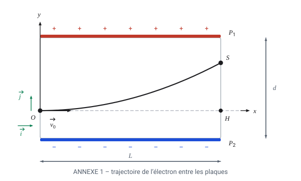

### Corrigé

#### Question 1.1

L'électron est attiré par l'armature $\oplus$ et repoussé par l'armature $\ominus$ ($P_2$).

$\Longrightarrow$ le champ $\vec{E}$ est **uniforme** :

- **direction** : perpendiculaire aux plaques ;
- **sens** : dirigé de $\oplus$ ($P_1$) vers $\ominus$ ($P_2$).

Or $\vec{F_{e}} = q \times \vec{E} = (-e)\,\vec{E}$ :

- $\Longrightarrow \vec{F_{e}}$ est colinéaire à $\vec{E}$ et **de sens opposé** ;
- $\Longrightarrow \vec{F_{e}}$ est perpendiculaire aux plaques et dirigée de $P_2$ vers $P_1$.

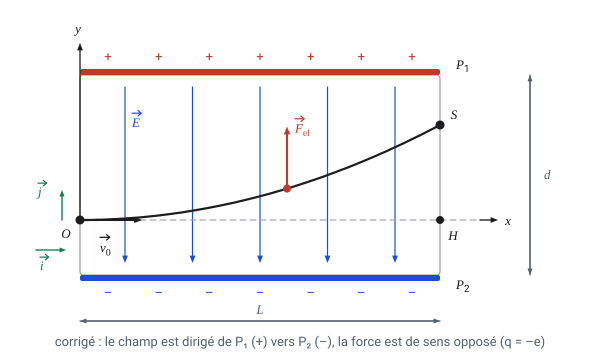

> **En clair (l'ordre du raisonnement).** Il faut le dérouler dans ce sens, et le rédiger ainsi :
> 1. **On regarde la trajectoire** : elle se courbe vers $P_1$. Donc la force $\vec{F_e}$ est dirigée vers $P_1$ — une trajectoire se courbe toujours **du côté où tire la force**.
> 2. **On en déduit le champ** : l'électron est négatif, donc $\vec{F_e} = (-e)\vec{E}$ est **opposée** à $\vec{E}$. Le champ pointe donc de $P_1$ vers $P_2$.
> 3. **On en déduit les signes des plaques** : le champ va toujours du $\oplus$ vers le $\ominus$, donc $P_1$ est la plaque **positive** et $P_2$ la négative.
> Autre formulation, plus rapide : l'électron est négatif, il est donc **attiré par la plaque positive** $P_1$ — et c'est bien vers elle qu'il dévie.
> **Erreur à éviter** : dessiner $\vec{F_e}$ et $\vec{E}$ dans le même sens. Pour une charge négative, ils sont **toujours opposés**.

#### Question 1.2

$d = 5\ \mathrm{cm}$ et $E = \dfrac{U}{d}$, donc :

$$U = U_{P_1 P_2} = E \times d$$

**A.N. :**

$$U = 1{,}6 \times 10^{4}\ \mathrm{V\,m^{-1}} \times 5 \times 10^{-2}\ \mathrm{m} = 8{,}0 \times 10^{2}\ \mathrm{V}$$

> **En clair.** « A.N. » signifie **application numérique** : on remplace les lettres par les valeurs, une fois la formule établie en lettres (c'est l'ordre attendu par le barème).
> Le seul piège est la conversion : $5\ \mathrm{cm} = 5 \times 10^{-2}\ \mathrm{m}$. Avec des centimètres oubliés, on trouverait 80 000 V au lieu de 800 V.
> Vérification du résultat : 800 V sur 5 cm, c'est très au-dessus d'une pile, mais tout à fait courant dans un tube cathodique. Les données $L$ et $v_0$ ne servent pas ici — elles seraient utiles pour calculer la déviation, donc $e/m_e$.

---

# Partie D — Annexe

## 6. Annexe

### 6.1. Exemple d'examen du Baccalauréat

#### Question 1 : Champs — Page 1/3

**a)** Un condensateur est chargé jusqu'à obtenir une différence de potentiel $U$ entre les plaques.

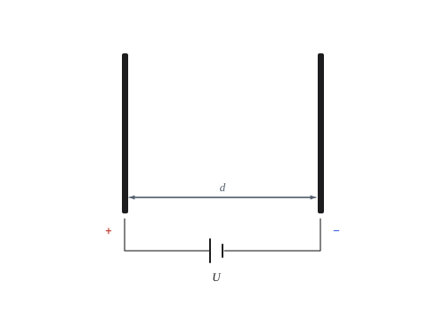

Le champ électrique entre des corps chargés est caractérisé par les lignes de champ.

| | Question | Barème |
|---|---|---|
| **i.** | Donner trois caractéristiques décrivant comment les lignes de champ électrique se dessinent entre des surfaces conductrices chargées. | 3 points |
| **ii.** | Copier les deux plaques de la figure ci-dessus et esquisser les lignes de champ et les équipotentielles. | 2 points |
| **iii.** | Une petite balle chargée positivement est maintenant centrée entre les deux plaques (figure ci-dessous). Recopier les deux plaques et la balle, et tracer les lignes de champ. | 2 points |

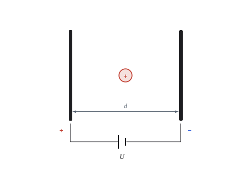

#### Question 1 : Champs — Page 2/3

**b)** Dans son expérience historique, Robert Millikan a déterminé la charge électrique élémentaire en pulvérisant des gouttelettes d'huile dans le champ électrique vertical d'un condensateur.

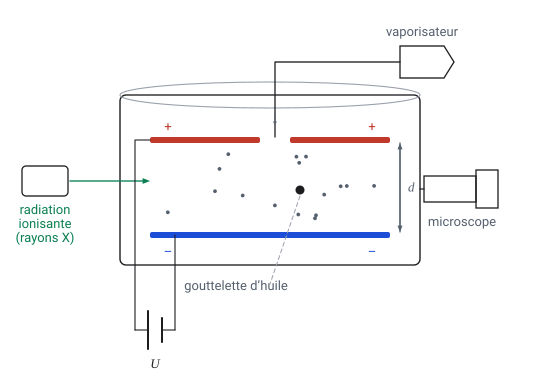

La goutte peut être observée à l'aide d'un microscope fixé à l'appareil et, selon la différence de potentiel appliquée entre les plaques du condensateur, elle se déplace vers le haut, vers le bas, ou reste immobile.

> **L'idée de l'expérience, en trois phrases.** On pulvérise un brouillard d'huile ; en se frottant au passage du pulvérisateur et sous l'effet des rayons X, chaque gouttelette capte ou perd **quelques électrons** : elle porte donc une charge $q$, toute petite et inconnue.
> On la place entre deux plaques et on règle la tension jusqu'à ce qu'elle **reste parfaitement immobile** : à cet instant, la force électrique compense exactement le poids, ce qui permet de calculer $q$.
> En recommençant sur des milliers de gouttes, Millikan constate que toutes les charges trouvées sont des **multiples d'une même petite valeur** : la charge élémentaire $e$. Prix Nobel 1923.


| | Question | Barème |
|---|---|---|
| **i.** | Décrire comment cette expérience est réalisée, en accordant une attention particulière aux points suivants : le rôle des rayons X ; le rôle du microscope ; les conditions pour qu'une gouttelette puisse se déplacer vers le haut, vers le bas ou rester en suspension. | 4 points |
| **ii.** | Le rayon $r$ de la gouttelette peut être mesuré et permet de calculer sa masse $m$. En négligeant la flottabilité, la charge $q$ d'une seule gouttelette d'huile **en suspension** peut alors être déterminée à l'aide de l'équation $q = \dfrac{m \cdot g \cdot d}{U}$, où $g$ est l'accélération de la pesanteur, $d$ la distance entre les plaques et $U$ la tension électrique appliquée. **Démontrer cette équation.** | 3 points |

#### Question 1 : Champs — Page 3/3

**iii.** La figure ci-dessous montre les résultats d'une série de mesures de 50 gouttelettes d'huile. **Interpréter ces résultats.** *(4 points)*

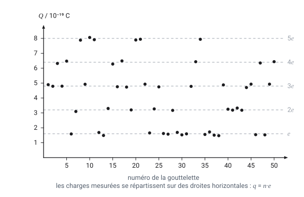

**c)** Dans une deuxième série d'expériences avec deux plaques distantes de $d = 2{,}76\ \mathrm{mm}$, les valeurs mesurées pour 6 gouttelettes d'huile ont été enregistrées afin de déterminer la charge électrique élémentaire.

| expérience | 1 | 2 | 3 | 4 | 5 | 6 |
|---|---|---|---|---|---|---|
| $U\ /\ \mathrm{V}$ | 52 | 174 | 88 | 117 | 138 | 92 |
| $m\ /\ 10^{-16}\ \mathrm{kg}$ | 6,16 | 10,2 | 15,4 | 7,05 | 16,7 | 22,0 |

En utilisant la formule donnée dans la partie **b) ii** (avec $g = 9{,}81\ \mathrm{m\,s^{-2}}$[^g]), calculer la charge $q$ de chaque gouttelette d'huile, et expliquer (sans calcul) comment trouver la charge électrique élémentaire. *(5 points)*

**d)** Expliquer l'importance de l'expérience de Millikan pour le développement de la physique quantique. *(2 points)*

[^g]: Le sujet original indique « $9{,}81\ \mathrm{ms^{-1}}$ » ; il s'agit d'une coquille pour $\mathrm{m\,s^{-2}}$.

---

### Solution de la Question 1 *(total : 25 points)*

#### a) i. *(3 points)* — réponse manuscrite

Les lignes de champ électrique :

- sont **perpendiculaires aux plaques** ;
- sont **orientées de l'armature $\oplus$ vers l'armature $\ominus$** ;
- sont **parallèles entre elles** (quand on est proche du centre).

> **En clair.** Trois caractéristiques, trois points : une idée par ligne, c'est exactement ce qu'attend le barème. On pourrait ajouter, au choix : « elles sont régulièrement espacées, car le champ est uniforme » ou « elles ne se croisent jamais ».

#### a) ii. *(2 points)* — schéma

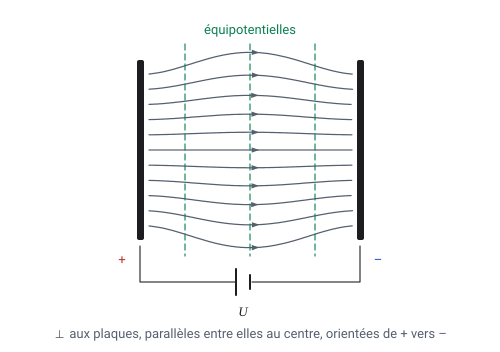

> **En clair.** Deux familles de traits à ne pas mélanger : les lignes de champ **fléchées**, perpendiculaires aux plaques ; les équipotentielles **en pointillés**, parallèles aux plaques. Et les deux se coupent à angle droit (voir A.9).

#### a) iii. *(2 points)* — schéma

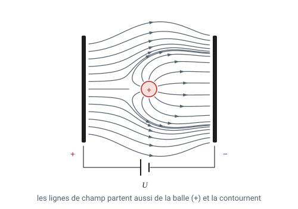

Les lignes de champ partent aussi de la balle (charge $+$) et la contournent ; elles restent perpendiculaires aux surfaces conductrices.

> **En clair.** La balle positive est une **nouvelle source** de lignes de champ : elles en sortent (règle du $\oplus$ = source) et rejoignent la plaque négative. Près de la balle, elles doivent partir **perpendiculairement à sa surface**, donc radialement. Le champ, uniforme ailleurs, est **déformé** au voisinage de la balle.

#### b) i. *(4 points)*

- **Rôle des rayons X** : ils ionisent l'air de la chambre, ce qui permet aux gouttelettes d'huile pulvérisées de capter (ou de perdre) un nombre entier d'électrons, donc d'acquérir une charge $q$.
- **Rôle du microscope** : il permet d'observer une gouttelette individuelle, de mesurer son rayon $r$ (donc sa masse $m$) et de repérer si elle monte, descend ou reste immobile.
- **Conditions de mouvement** (pour une gouttelette de charge négative, plaque supérieure $\oplus$) :
  - $F_{el} > P$ : la gouttelette **monte** ;
  - $F_{el} < P$ : la gouttelette **descend** ;
  - $F_{el} = P$ : la gouttelette **reste en suspension**.

> **En clair.** *Ioniser* = arracher des électrons aux molécules de l'air ; ces électrons libres se collent ensuite aux gouttelettes. Sans cela, les gouttes seraient neutres et le champ n'aurait aucune prise sur elles.
> Les gouttes sont **beaucoup trop petites pour être vues à l'œil nu** (quelques micromètres) : d'où le microscope.
> La troisième condition est celle qu'on exploite : **immobile = les deux forces se compensent**. C'est le seul cas où l'on peut écrire une égalité simple, donc le seul qui permette de calculer $q$.

#### b) ii. *(3 points)*

Pour une gouttelette maintenue **en suspension**, la force électrostatique compense le poids :

$$F_{e} = F_{g}
\;\Longrightarrow\; E\,q = m\,g
\;\Longrightarrow\; \frac{U}{d}\,q = m\,g
\;\Longrightarrow\; \boxed{\;q = \frac{m \cdot g \cdot d}{U}\;}$$

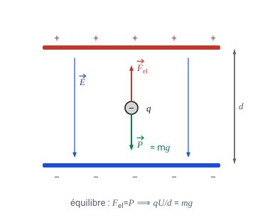

> **En clair, étape par étape.**
> 1. La goutte est **immobile** : les deux forces qu'elle subit se compensent exactement (même valeur, sens opposés). D'où $F_e = F_g$.
> 2. Le poids vaut $F_g = m\,g$ (cours de mécanique) et la force électrique vaut $F_e = q\,E$ (cours, III.1).
> 3. Entre deux plaques, $E = U/d$ (cours, III.2) : on remplace.
> 4. On isole $q$ : $q = \dfrac{m g d}{U}$.
> Rien n'est deviné : chaque étape est une formule du cours. Les trois points du barème correspondent d'ailleurs à ces trois formules.

#### b) iii. *(4 points)*

Les points se situent approximativement le long de plusieurs **droites horizontales**. On peut voir que les gouttelettes d'huile n'ont que des charges $q$ dont les valeurs sont un **multiple entier** d'une certaine charge $e$ :

$$q = n\,e \qquad \text{avec } n \text{ entier}$$

Cette charge particulière $e$ est la **charge électrique élémentaire**. Les écarts par rapport aux valeurs $q = n\,e$ peuvent être attribués aux imprécisions de la mesure.

> **En clair.** C'est le cœur de l'expérience. Si la charge pouvait prendre n'importe quelle valeur, le nuage de points serait **réparti au hasard** sur le graphique. Or les points s'alignent sur des **paliers** : certaines valeurs de charge existent, d'autres non.
> Comparaison : si tu pèses des sacs de pièces de 2 €, tu trouveras 2 €, 4 €, 6 €… jamais 3,40 €. L'existence de paliers prouve l'existence d'une **pièce élémentaire**.

#### c) *(5 points)*

Avec GeoGebra, nous obtenons pour les charges :

| gouttelette | 1 | 2 | 3 | 4 | 5 | 6 |
|---|---|---|---|---|---|---|
| $U\ /\ \mathrm{V}$ | 52 | 174 | 88 | 117 | 138 | 92 |
| $m\ /\ 10^{-16}\ \mathrm{kg}$ | 6,16 | 10,2 | 15,4 | 7,05 | 16,7 | 22,0 |
| $q\ /\ 10^{-19}\ \mathrm{C}$ | 3,21 | 1,59 | 4,74 | 1,63 | 3,28 | 6,47 |

*Exemple de calcul (gouttelette 1) :*

$$q_{1} = \frac{m\,g\,d}{U}
= \frac{6{,}16 \times 10^{-16} \times 9{,}81 \times 2{,}76 \times 10^{-3}}{52}
\approx 3{,}21 \times 10^{-19}\ \mathrm{C}$$

**Méthode (sans calcul) :** trouver la valeur la plus faible de $q$ dans le tableau ci-dessus. Ensuite, diviser toutes les charges par cette charge minimale pour vérifier si elles en sont des multiples. Si oui (dans la marge d'erreur), il s'agit de la charge électrique élémentaire.

Le calcul n'est pas nécessaire ; néanmoins il est indiqué ici. Les charges dont les valeurs sont les plus faibles sont les n° **2** et **4** ; il est donc préférable d'utiliser leur **moyenne** :

$$q_{2,4} = \frac{1{,}59 + 1{,}63}{2} \times 10^{-19} \approx 1{,}61 \times 10^{-19}\ \mathrm{C}$$

| gouttelette | 1 | 2 | 3 | 4 | 5 | 6 |
|---|---|---|---|---|---|---|
| $q\ /\ 10^{-19}\ \mathrm{C}$ | 3,21 | 1,59 | 4,74 | 1,63 | 3,28 | 6,47 |
| $q\ /\ q_{2,4}$ | 1,99 | 0,99 | 2,94 | 1,01 | 2,04 | 4,02 |

Dans la marge d'erreur, toutes les charges sont des **multiples entiers** de $q_{2,4} \approx e$.

> **En clair.** Attention aux unités avant de taper la calculatrice : $m$ est donnée **en $10^{-16}$ kg** (donc la goutte 1 pèse $6{,}16 \times 10^{-16}$ kg) et $d = 2{,}76\ \mathrm{mm} = 2{,}76 \times 10^{-3}\ \mathrm{m}$.
> Pourquoi prendre la **moyenne** de 2 et 4 plutôt que la plus petite valeur seule ? Parce que chaque mesure comporte une incertitude : faire la moyenne de deux mesures du même palier réduit l'erreur. On obtient $1{,}61 \times 10^{-19}$ C, à comparer à la valeur admise $1{,}602 \times 10^{-19}$ C — moins de 1 % d'écart.
> Dernière ligne : $1{,}99 \approx 2$, $0{,}99 \approx 1$, $2{,}94 \approx 3$, … tous les rapports tombent sur des **entiers**. C'est la preuve demandée.

#### d) *(2 points)*

La différence importante entre la physique classique et la physique quantique est la **quantification**.

La quantification de la charge électrique a été la **première découverte** de ce type, grâce à l'expérience de Millikan.

Cela a contribué à faire naître l'idée que **d'autres grandeurs physiques pourraient également être quantifiées**.

> **En clair.** *Quantifié* veut dire : qui ne peut prendre que certaines valeurs, par paquets — par opposition à *continu*, qui peut prendre toutes les valeurs intermédiaires. Une rampe est continue, un escalier est quantifié.
> En physique classique, on supposait toutes les grandeurs continues. Millikan montre que la charge, elle, est un escalier. On découvrira ensuite que l'énergie de la lumière (les photons) et les niveaux d'énergie des atomes le sont aussi : c'est la naissance de la physique quantique.

---

# Partie E — Le champ électrique au travail

L'électrostatique n'est pas qu'une curiosité de laboratoire : c'est une technologie. Voici cinq applications où tout ce qui précède sert directement.

## E.1. L'imprimante à jet d'encre

> **TL;DR.** Comment une imprimante place 10 000 gouttes par seconde exactement où il faut : le champ entre les plaques ne change pas, c'est la **charge donnée à chaque goutte** qui décide de sa déviation.

Le canon à encre produit environ 10 000 gouttelettes par seconde. Chacune traverse une **électrode de charge** qui lui donne, à la demande de l'ordinateur, une charge $q$ plus ou moins grande. Les gouttes passent ensuite entre deux plaques de déviation, où règne un champ $\vec{E}$ constant.

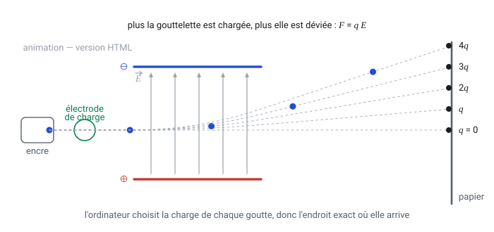

Comme $\vec{F} = q\,\vec{E}$ et que $\vec{E}$ ne change pas, **c'est la charge qui décide de la déviation** : l'ordinateur place ainsi chaque goutte exactement où il veut. Les gouttes qui ne doivent pas être imprimées (les espaces entre les mots) ne sont pas chargées du tout : elles filent tout droit et sont récupérées dans une gouttière.

C'est le même dispositif que l'expérience de Thomson, à ceci près qu'on y fait varier la charge au lieu de la mesurer.

> **À retenir pour les exercices**
>
> - $\vec{F} = q\,\vec{E}$ à champ constant : la déviation est **proportionnelle à la charge**.
> - Une goutte **non chargée** n'est pas déviée du tout : c'est ainsi qu'on fait les espaces entre les mots.
> - C'est le dispositif de l'expérience de Thomson, utilisé à l'envers : ici on impose la charge, là-bas on la mesure.

## E.2. La photocopieuse et l'imprimante laser

> **TL;DR.** Les quatre étapes, toutes électrostatiques, d'une photocopieuse ou d'une imprimante laser : charger le tambour, l'éclairer, le poudrer, transférer sur le papier.

Quatre étapes, toutes électrostatiques :

1. Un fil à haute tension charge **positivement** la surface isolante d'un tambour.
2. On projette sur le tambour l'image lumineuse du document. **La lumière fait fuir les charges** : les zones éclairées (le blanc du papier) se déchargent, les zones restées sombres (le texte) gardent leur charge. Le tambour porte maintenant une image faite de charges.
3. On saupoudre une poudre d'encre (le *toner*) chargée **négativement** : elle est attirée uniquement par les zones restées positives.
4. Une feuille passe sur le tambour, attirée par un fil de transfert positif placé dessous ; la poudre saute sur le papier, que des rouleaux chauffants viennent fixer définitivement.

> **À retenir pour les exercices**
>
> - La **lumière fait fuir les charges** : les zones éclairées se déchargent, et l'image portée par le tambour est une image **faite de charges**.
> - Le toner **négatif** ne se colle que sur les zones restées **positives** : attraction de signes opposés.
> - Le papier, neutre, est attiré par influence (A.3) grâce à un fil de transfert placé dessous.

## E.3. La peinture et les pesticides électrostatiques

> **TL;DR.** Pourquoi une peinture chargée s'étale toute seule de façon régulière et vient se coller **y compris sur les faces cachées** de l'objet.

La buse charge positivement les gouttelettes de peinture. Deux effets se combinent :

- les gouttelettes, toutes de même signe, **se repoussent** : le nuage s'étale tout seul, de façon régulière ;
- l'objet à peindre, relié à la terre, se charge **négativement par influence** : les gouttes suivent les lignes de champ et viennent se coller dessus, y compris **sur les faces cachées**, car les lignes de champ contournent l'objet.

Résultat : presque pas de peinture perdue, et une couche uniforme. On traite de la même façon les cultures — les parasites vivent sous les feuilles, là où un pulvérisateur ordinaire n'atteint rien.

> **À retenir pour les exercices**
>
> - Les gouttes, toutes de **même signe**, se repoussent : le nuage s'uniformise sans aucun réglage.
> - L'objet relié à la terre prend une charge **opposée par influence** ; les gouttes suivent les lignes de champ, qui **contournent** l'objet.
> - Même principe pour les pesticides : les parasites vivent sous les feuilles, là où un jet ordinaire n'arrive pas.

## E.4. Le dépoussiéreur électrostatique

> **TL;DR.** Comment on retient plus de 99 % des suies d'une cheminée d'usine avec des fils à haute tension et des plaques collectrices.

Dans les cheminées d'usine, les fumées passent près de fils portés à très haute tension négative. Les particules de suie se chargent, puis sont attirées par des plaques collectrices positives, d'où on les décolle périodiquement. Un dépoussiéreur bien réglé retient plus de 99 % des particules.

> **À retenir pour les exercices**
>
> - On **charge** d'abord les particules, puis on les attire avec une électrode de signe **opposé** : c'est encore $\vec{F} = q\,\vec{E}$.
> - Le champ doit être très intense près des fils pour ioniser l'air : on y retrouve le seuil de claquage.

## E.5. L'éclair et le paratonnerre

> **TL;DR.** Pourquoi l'air, isolant, finit par devenir **conducteur** sous un nuage d'orage, et pourquoi la décharge choisit toujours la pointe la plus haute.

Dans un nuage d'orage, les frottements entre cristaux de glace séparent les charges : le bas du nuage devient très négatif. Le champ entre le nuage et le sol grandit ; dès qu'il dépasse $3 \times 10^{6}\ \mathrm{V\,m^{-1}}$, l'air **devient conducteur** et la décharge se produit — c'est l'éclair.

Le paratonnerre exploite un effet de pointe : près d'une pointe, les équipotentielles sont très serrées, donc le champ est énorme. La décharge se déclenche là en priorité, et le courant est conduit proprement jusqu'au sol.

> **Pourquoi est-il dangereux de rester debout au milieu d'un champ pendant un orage ?** Parce que les équipotentielles, horizontales loin de tout obstacle, se déforment autour du point le plus haut — et c'est toi. Le champ est alors maximal à ton sommet : tu joues le rôle du paratonnerre.

> **À retenir pour les exercices**
>
> - Claquage de l'air sec : $E \approx 3 \times 10^{6}\ \mathrm{V\,m^{-1}}$. En dessous, rien ne se passe ; au-dessus, l'étincelle jaillit.
> - **Effet de pointe** : près d'une pointe les équipotentielles sont très serrées, donc $E = -\Delta V/\Delta r$ est énorme — la décharge part de là.
> - Conséquence pour toi : dans un terrain découvert, la pointe la plus haute, c'est ta tête.

---

# Partie F — Méthode, erreurs et auto-test

## F.1. Méthode en 5 étapes pour n'importe quel exercice

> **TL;DR.** La marche à suivre pour **n'importe quel** exercice du chapitre, du schéma jusqu'à la vérification de l'ordre de grandeur. À appliquer aux parties C et G.

1. **Faire un schéma.** Placer les charges, leurs signes, le point où l'on cherche quelque chose. Un exercice d'électrostatique sans schéma est un exercice perdu.
2. **Repérer la situation.** Il n'y en a que trois dans ce chapitre :
   - une (ou plusieurs) **charge ponctuelle** → champ radial, $E = k\,\lvert Q \rvert / r^{2}$ ;
   - **deux plaques** → champ uniforme, $E = U/d$ ;
   - **plusieurs charges** → on calcule chaque champ séparément, puis on additionne les vecteurs.
3. **Écrire la formule en lettres**, et seulement ensuite remplacer par les nombres (c'est ce que valorise le barème).
4. **Convertir en unités SI** : cm → m, mm → m, µC → C, g → kg. Puis calculer.
5. **Vérifier.** L'ordre de grandeur est-il plausible ? L'unité est-elle la bonne ? Le sens de la flèche est-il cohérent avec les signes des charges ?

> **À retenir pour les exercices**
>
> - Il n'existe que **trois situations** : une charge ponctuelle ($E = k\lvert Q \rvert/r^{2}$), deux plaques ($E = U/d$), plusieurs charges (somme vectorielle).
> - Toujours dans cet ordre : schéma → formule **en lettres** → conversion en SI → valeurs → vérification. Le barème paie la formule en lettres.
> - Vérifier trois choses à la fin : l'**unité**, l'**ordre de grandeur**, et le **sens** de la flèche par rapport aux signes des charges.

## F.2. Les erreurs classiques

> **TL;DR.** Le tableau des neuf erreurs qui coûtent le plus de points, avec la correction de chacune. C'est la page à relire juste avant un contrôle.

| Erreur fréquente | Ce qu'il faut faire |
|---|---|
| Oublier de convertir les cm en m | $5\ \mathrm{cm} = 0{,}05\ \mathrm{m}$ — sinon on se trompe d'un facteur 100 |
| Oublier le carré sur la puissance de 10 | $(2 \times 10^{-2})^{2} = 4 \times 10^{-4}$, pas $4 \times 10^{-2}$ |
| Additionner des normes au lieu des vecteurs | On additionne **coordonnée par coordonnée**, puis Pythagore |
| Dessiner $\vec{F}$ et $\vec{E}$ dans le même sens pour une charge négative | Pour $q<0$, ils sont **opposés** |
| Confondre la force et le champ | $\vec{F}$ s'applique à la charge qu'on a posée ; $\vec{E}$ existe même sans elle |
| Mettre une norme négative | $E$, $F$, $\lVert \vec{E} \rVert$ sont **toujours positifs** ; c'est le vecteur qui porte le sens |
| Dire « l'électron va dans le sens du champ » | Il est négatif : il **remonte** les lignes de champ |
| Croiser deux lignes de champ sur un schéma | Elles ne se croisent **jamais** |
| Confondre $U$ (une différence) et $V$ (un point) | $U = V_A - V_B$ |

> **À retenir pour les exercices**
>
> - Les deux erreurs de calcul : oublier de convertir les cm en m, et oublier que le carré porte **aussi** sur la puissance de 10.
> - Les deux erreurs de vecteurs : additionner des **normes** au lieu des coordonnées, et dessiner $\vec{F}$ dans le sens de $\vec{E}$ pour une charge **négative**.
> - Les deux erreurs de vocabulaire : confondre $\vec{F}$ (ce que subit la charge posée) et $\vec{E}$ (ce qui existe déjà), confondre $U$ (une différence) et $V$ (attaché à un point).
> - Et jamais de norme négative, jamais deux lignes de champ qui se croisent, jamais un électron « dans le sens du champ ».

## F.3. Auto-test

1. Un objet a perdu 3 électrons. Quelle est sa charge ?
2. Deux charges se repoussent. Que peut-on dire de leurs signes ?
3. On éloigne deux charges de 2 cm à 6 cm. La force est divisée par combien ?
4. Quelle est l'unité du champ électrique ? Donner les deux écritures.
5. Un champ vaut $5 \times 10^{3}\ \mathrm{V\,m^{-1}}$. Quelle force subit une charge de $2\ \mathrm{µC}$ ?
6. Entre deux plaques distantes de 4 cm règne une tension de 120 V. Que vaut $E$ ?
7. Dans quel sens pointe le champ créé par une charge négative ?
8. Vrai ou faux : si on retire la charge d'essai, le champ disparaît.
9. Deux champs de 3 et 4 $\mathrm{V\,m^{-1}}$, perpendiculaires, se superposent. Que vaut le champ résultant ?
10. Pourquoi les lignes de champ et les équipotentielles sont-elles perpendiculaires ?

### Réponses

1. $q = +3e = +4{,}8 \times 10^{-19}\ \mathrm{C}$ (elle a perdu du négatif, elle devient positive).
2. Elles sont de **même signe** (toutes deux positives ou toutes deux négatives).
3. La distance est multipliée par 3, la force est divisée par $3^{2} = 9$.
4. $\mathrm{V\,m^{-1}}$ ou $\mathrm{N\,C^{-1}}$ : les deux sont équivalentes.
5. $F = qE = 2 \times 10^{-6} \times 5 \times 10^{3} = 1 \times 10^{-2}\ \mathrm{N}$, soit 10 mN.
6. $E = U/d = 120 / 0{,}04 = 3 \times 10^{3}\ \mathrm{V\,m^{-1}}$.
7. **Vers** la charge : il est radial et centripète.
8. **Faux.** Le champ est créé par la charge source ; la charge d'essai ne fait que le révéler.
9. $\sqrt{3^{2}+4^{2}} = 5\ \mathrm{V\,m^{-1}}$ (Pythagore).
10. Parce que le champ suit la ligne de plus grande pente du potentiel, et qu'une ligne de plus grande pente coupe toujours une courbe de niveau à angle droit. Autrement dit : le long d'une équipotentielle, le potentiel ne varie pas, donc le champ n'a aucune composante dans cette direction.

---

# Partie G — Entraînement supplémentaire

> **Origine de ces exercices.** Les énoncés qui suivent sont **adaptés en français** du chapitre 21 (*Electric Fields*) de *Advanced Physics for You*, de K. Johnson, S. Hewett, S. Holt et J. Miller (Oxford University Press, 2e édition, 2015), ainsi que des questions d'examen britanniques (OCR, AQA, Edexcel) qu'il reproduit. Les situations et les valeurs numériques sont conservées, les textes ont été réécrits et les corrigés entièrement rédigés ici. Pour réviser ; pour les énoncés d'origine, les figures et le reste du chapitre, réfère-toi au manuel.
>
> **Données utiles :** $k = \dfrac{1}{4\pi\varepsilon_{0}} = 9{,}0 \times 10^{9}\ \mathrm{N\,m^{2}\,C^{-2}}$ ; $\varepsilon_{0} = 8{,}85 \times 10^{-12}\ \mathrm{F\,m^{-1}}$ ; $e = 1{,}6 \times 10^{-19}\ \mathrm{C}$ ; $m_{e} = 9{,}1 \times 10^{-31}\ \mathrm{kg}$ ; $g = 9{,}81\ \mathrm{N\,kg^{-1}}$.

## G.1. Questions de cours

**1.** Compléter :

a) La force électrique entre deux charges dépend de leurs …… et de leur …… .
b) La charge se mesure en …… ; un …… correspond à la charge de $6{,}25 \times 10^{18}$ …… .
c) Un champ électrique est une région où une …… subit une …… .
d) Dans un champ uniforme, les lignes de champ sont …… et …… .
e) Une surface qui relie tous les points de même potentiel s'appelle une …… .
f) Pour trouver l'énergie échangée quand une charge se déplace d'un point à un autre, on multiplie la …… par la …… .

> **Corrigé.** a) valeurs (et signes) / distance — b) coulombs ; coulomb ; électrons — c) charge ; force — d) parallèles ; régulièrement espacées — e) surface équipotentielle — f) différence de potentiel (tension) ; charge.

**2.** Citer deux ressemblances et une différence entre le champ de pesanteur et le champ électrique.

> **Corrigé.** Ressemblances : tous deux sont des champs de force en $1/r^{2}$ autour d'une source ponctuelle ; dans les deux cas la force sur un objet s'écrit « grandeur de l'objet × champ » ($\vec{P} = m\vec{g}$, $\vec{F} = q\vec{E}$) ; tous deux possèdent des équipotentielles perpendiculaires aux lignes de champ.
> Différence : la gravitation est **toujours attractive** (il n'existe pas de masse négative) alors que la force électrique attire **ou** repousse ; et elle est incomparablement plus faible (voir A.4).

**3.** Expliquer pourquoi aucun travail n'est nécessaire pour déplacer une charge le long d'une surface équipotentielle.

> **Corrigé.** Le travail vaut $W = q\,\Delta V$. Sur une équipotentielle, $\Delta V = 0$ par définition, donc $W = 0$. Autrement dit, le champ n'a aucune composante le long de l'équipotentielle (il lui est perpendiculaire) : il ne « pousse » ni ne « freine » dans cette direction.

## G.2. Loi de Coulomb

**4.** Deux sphères $A$ et $B$ portent chacune la charge $+Q$ et se repoussent avec une force $F$. Que devient cette force si :
a) on double la charge de $A$ seule ? b) on double les deux charges ? c) on double la distance ? d) on divise la distance par 3 ?

> **Corrigé.** $F = k\,Q^2/r^2$. a) $2F$ — b) $4F$ (le produit $Q_1Q_2$ est multiplié par 4) — c) $F/4$ — d) $9F$.

**5.** Deux petites sphères portent la même charge et sont distantes de $10\ \mathrm{cm}$. Elles se repoussent avec une force de $3{,}6 \times 10^{-6}\ \mathrm{N}$.
a) Quelle est la charge de chaque sphère ? b) Elles sont chargées négativement : combien d'électrons en excès chacune porte-t-elle ?

> **Corrigé.** a) $F = k\,q^{2}/r^{2}$ donc $q = \sqrt{\dfrac{F r^{2}}{k}} = \sqrt{\dfrac{3{,}6\times10^{-6} \times (0{,}10)^{2}}{9{,}0\times10^{9}}} = \sqrt{4{,}0\times10^{-18}} = 2{,}0 \times 10^{-9}\ \mathrm{C} = 2{,}0\ \mathrm{nC}$.
> b) $n = \dfrac{q}{e} = \dfrac{2{,}0\times10^{-9}}{1{,}6\times10^{-19}} = 1{,}25 \times 10^{10}$ électrons — soit 12,5 milliards, et pourtant une charge minuscule à notre échelle.

**6.** Dans un atome d'hydrogène, l'électron est à environ $5{,}3 \times 10^{-11}\ \mathrm{m}$ du proton.
a) Calculer la force électrique entre eux. b) La comparer au poids de l'électron ($m_e g$).

> **Corrigé.** a) $F = \dfrac{9{,}0\times10^{9} \times (1{,}6\times10^{-19})^{2}}{(5{,}3\times10^{-11})^{2}} = \dfrac{2{,}30\times10^{-28}}{2{,}81\times10^{-21}} \approx 8{,}2 \times 10^{-8}\ \mathrm{N}$.
> b) $P = m_e\,g = 9{,}1\times10^{-31} \times 9{,}81 \approx 8{,}9 \times 10^{-30}\ \mathrm{N}$. La force électrique est environ $10^{22}$ fois plus grande que le poids : à l'échelle de l'atome, la pesanteur ne compte pour rien. (Entre le proton et l'électron eux-mêmes, l'attraction électrique dépasse l'attraction gravitationnelle d'un facteur $\approx 2 \times 10^{39}$.)

## G.3. Champ électrique

**7.** Calculer le champ électrique créé par une charge ponctuelle de $16\ \mathrm{nC}$ à a) $2{,}0\ \mathrm{cm}$ et b) $4{,}0\ \mathrm{cm}$. Commenter.

> **Corrigé.** a) $E = k\dfrac{\lvert Q\rvert}{r^{2}} = \dfrac{9{,}0\times10^{9}\times16\times10^{-9}}{(2{,}0\times10^{-2})^{2}} = \dfrac{144}{4{,}0\times10^{-4}} = 3{,}6 \times 10^{5}\ \mathrm{V\,m^{-1}}$.
> b) $E = \dfrac{144}{1{,}6\times10^{-3}} = 9{,}0 \times 10^{4}\ \mathrm{V\,m^{-1}}$.
> Commentaire : la distance a doublé, le champ a été divisé par 4 — la loi en $1/r^{2}$ en action.

**8.** Quelle force subit une charge de $2{,}4\ \mathrm{nC}$ placée dans un champ de $4{,}0 \times 10^{3}\ \mathrm{N\,C^{-1}}$ ?

> **Corrigé.** $F = qE = 2{,}4\times10^{-9} \times 4{,}0\times10^{3} = 9{,}6 \times 10^{-6}\ \mathrm{N}$, dans le sens de $\vec{E}$ puisque la charge est positive.

**9.** Deux charges ponctuelles $+4{,}0\ \mathrm{nC}$ et $+2{,}0\ \mathrm{nC}$ sont distantes de $6{,}0\ \mathrm{cm}$. Soit $P$ le milieu du segment.
a) Quel est le champ résultant en $P$ ? b) Et si on remplace la charge $+2{,}0\ \mathrm{nC}$ par $-2{,}0\ \mathrm{nC}$ ?

> **Corrigé.** Chaque charge est à $3{,}0\ \mathrm{cm}$ de $P$.
> $E_1 = \dfrac{9{,}0\times10^{9}\times4{,}0\times10^{-9}}{(3{,}0\times10^{-2})^{2}} = 4{,}0\times10^{4}\ \mathrm{V\,m^{-1}}$ et $E_2 = 2{,}0\times10^{4}\ \mathrm{V\,m^{-1}}$.
> a) Les deux charges sont positives : leurs champs en $P$ pointent **en sens contraires**. On soustrait : $E = 4{,}0\times10^{4} - 2{,}0\times10^{4} = 2{,}0 \times 10^{4}\ \mathrm{V\,m^{-1}}$, dirigé de la charge $+4{,}0$ nC vers la charge $+2{,}0$ nC (la plus grande l'emporte).
> b) Avec une charge négative, le second champ pointe **vers** elle, donc dans le même sens que le premier. On additionne : $E = 6{,}0 \times 10^{4}\ \mathrm{V\,m^{-1}}$.
> *Morale : ne jamais additionner les valeurs sans avoir dessiné les deux flèches.*

**10.** Deux plaques parallèles distantes de $10\ \mathrm{cm}$ sont reliées à une alimentation de $5{,}0\ \mathrm{kV}$.
a) Quel est le champ entre les plaques ? b) Quelle force subit une charge de $+4{,}0\ \mathrm{nC}$ placée entre elles ?

> **Corrigé.** a) $E = \dfrac{U}{d} = \dfrac{5{,}0\times10^{3}}{0{,}10} = 5{,}0 \times 10^{4}\ \mathrm{V\,m^{-1}}$.
> b) $F = qE = 4{,}0\times10^{-9} \times 5{,}0\times10^{4} = 2{,}0 \times 10^{-4}\ \mathrm{N}$, dirigée de la plaque $\oplus$ vers la plaque $\ominus$.

**11.** Une étincelle jaillit dans l'air sec dès que le champ atteint $3{,}0 \times 10^{6}\ \mathrm{V\,m^{-1}}$.
a) L'écartement des électrodes d'une bougie d'allumage est de $0{,}80\ \mathrm{mm}$. Quelle tension faut-il appliquer ?
b) Une ligne haute tension est à $1{,}86 \times 10^{5}\ \mathrm{V}$. À quelle distance peut-on s'en approcher avant de recevoir une décharge ?

> **Corrigé.** a) $U = E\,d = 3{,}0\times10^{6} \times 0{,}80\times10^{-3} = 2{,}4 \times 10^{3}\ \mathrm{V}$, soit 2,4 kV.
> b) $d = \dfrac{U}{E} = \dfrac{1{,}86\times10^{5}}{3{,}0\times10^{6}} = 6{,}2 \times 10^{-2}\ \mathrm{m}$, soit **6,2 cm** : l'air lui-même cesse d'être isolant à cette distance.

**12.** Le dôme d'un générateur de Van de Graaff est une sphère de rayon $15\ \mathrm{cm}$.
a) Quelle charge porte-t-il quand le champ à sa surface atteint $3{,}0 \times 10^{6}\ \mathrm{V\,m^{-1}}$ ? b) Quel est alors son potentiel ?

> **Corrigé.** La sphère se comporte comme une charge ponctuelle placée en son centre.
> a) $Q = \dfrac{E\,r^{2}}{k} = \dfrac{3{,}0\times10^{6} \times (0{,}15)^{2}}{9{,}0\times10^{9}} = 7{,}5 \times 10^{-6}\ \mathrm{C} = 7{,}5\ \mathrm{µC}$.
> b) $V = k\dfrac{Q}{r} = \dfrac{9{,}0\times10^{9}\times7{,}5\times10^{-6}}{0{,}15} = 4{,}5 \times 10^{5}\ \mathrm{V}$ (soit 450 kV ; on peut aussi écrire directement $V = E \times r$).

**13.** *(d'après OCR)* Deux charges ponctuelles, $+1{,}6 \times 10^{-19}\ \mathrm{C}$ en $A$ et $-6{,}4 \times 10^{-19}\ \mathrm{C}$ en $B$, sont distantes de $8{,}0 \times 10^{-10}\ \mathrm{m}$.
a) Calculer le champ au milieu de $[AB]$ (valeur et sens).
b) Il existe sur la droite $(AB)$, à l'extérieur du segment, un point $P$ où le champ est nul. Où se trouve-t-il ?
c) Que peut-on dire du sens du champ de part et d'autre de $P$ ?

> **Corrigé.** a) Au milieu, chaque charge est à $4{,}0\times10^{-10}\ \mathrm{m}$.
> $E_A = \dfrac{9{,}0\times10^{9}\times1{,}6\times10^{-19}}{(4{,}0\times10^{-10})^{2}} = 9{,}0\times10^{9}\ \mathrm{V\,m^{-1}}$ (il s'éloigne de $A$) et $E_B = 3{,}6\times10^{10}\ \mathrm{V\,m^{-1}}$ (il se dirige vers $B$). Les deux pointent **de $A$ vers $B$** : $E = 4{,}5 \times 10^{10}\ \mathrm{V\,m^{-1}}$, de $A$ vers $B$.
> b) Le point d'annulation est forcément **du côté de la plus petite charge**, à l'extérieur. En notant $x$ sa distance à $A$ : $\dfrac{k\lvert q_A\rvert}{x^{2}} = \dfrac{k\lvert q_B\rvert}{(x+d)^{2}}$, soit $\dfrac{x+d}{x} = \sqrt{\dfrac{6{,}4}{1{,}6}} = 2$, d'où $x = d = 8{,}0 \times 10^{-10}\ \mathrm{m}$ : $P$ est à $8{,}0 \times 10^{-10}\ \mathrm{m}$ de $A$, du côté opposé à $B$.
> c) Le champ **change de sens** en $P$ : au-delà de $P$ (loin des charges) il est dirigé vers $B$, car c'est la charge négative qui domine de loin ; entre $P$ et $A$, c'est la charge $+$ qui l'emporte et le champ est dirigé en sens inverse.

## G.4. Potentiel et énergie

**14.** Une sphère conductrice isolée de rayon $12\ \mathrm{cm}$ reçoit une charge de $0{,}16\ \mathrm{nC}$. Quel est son potentiel ?

> **Corrigé.** $V = k\dfrac{Q}{r} = \dfrac{9{,}0\times10^{9}\times0{,}16\times10^{-9}}{0{,}12} = 12\ \mathrm{V}$. Tout le conducteur est à ce potentiel, et le champ est nul à l'intérieur.

**15.** *(d'après AQA)* Trois points $L$, $M$ et $N$ sont alignés avec une petite charge positive $Q$, respectivement à $0{,}30$, $0{,}60$ et $0{,}90\ \mathrm{m}$ de celle-ci. Le potentiel en $L$ vaut $+3{,}0\ \mathrm{V}$.
a) Calculer $Q$. b) Montrer que le potentiel en $N$ vaut $+1{,}0\ \mathrm{V}$. c) Montrer que le champ en $M$ vaut $2{,}5\ \mathrm{V\,m^{-1}}$.

> **Corrigé.** a) $V = kQ/r$ donc $Q = \dfrac{V r}{k} = \dfrac{3{,}0 \times 0{,}30}{9{,}0\times10^{9}} = 1{,}0 \times 10^{-10}\ \mathrm{C}$ (soit 0,10 nC).
> b) $V_N = \dfrac{9{,}0\times10^{9}\times1{,}0\times10^{-10}}{0{,}90} = \dfrac{0{,}90}{0{,}90} = 1{,}0\ \mathrm{V}$. (On pouvait aller plus vite : la distance est triplée et $V$ varie en $1/r$, donc $V$ est divisé par 3.)
> c) $E_M = k\dfrac{Q}{r^{2}} = \dfrac{0{,}90}{(0{,}60)^{2}} = \dfrac{0{,}90}{0{,}36} = 2{,}5\ \mathrm{V\,m^{-1}}$.

**16.** *(d'après AQA)* Deux charges de $+0{,}8\ \mathrm{nC}$ sont distantes de $40\ \mathrm{mm}$. Le point $P$ est à $40\ \mathrm{mm}$ de chacune d'elles (triangle équilatéral). Que vaut le potentiel en $P$ ? **A** 0 **B** 180 V **C** 360 V **D** 4500 V

> **Corrigé.** **C.** Le potentiel est un **scalaire** : on additionne de simples nombres, sans se préoccuper des directions.
> $V = 2 \times k\dfrac{Q}{r} = 2 \times \dfrac{9{,}0\times10^{9}\times0{,}8\times10^{-9}}{0{,}040} = 2 \times 180 = 360\ \mathrm{V}$.
> *Piège classique :* le **champ** en $P$, lui, ne vaut pas deux fois le champ d'une charge, car il faut composer deux vecteurs qui font entre eux un angle de 60°.

**17.** Quel travail faut-il fournir pour déplacer une charge de $3{,}6\ \mathrm{pC}$ depuis une distance de $0{,}50\ \mathrm{m}$ jusqu'à $0{,}75\ \mathrm{m}$ d'une charge ponctuelle de $-4{,}0\ \mathrm{nC}$ ?

> **Corrigé.** On calcule les deux potentiels (attention au signe de la charge source) :
> $V_1 = \dfrac{9{,}0\times10^{9} \times (-4{,}0\times10^{-9})}{0{,}50} = -72\ \mathrm{V}$ et $V_2 = \dfrac{-36}{0{,}75} = -48\ \mathrm{V}$.
> $\Delta V = V_2 - V_1 = -48 - (-72) = +24\ \mathrm{V}$, donc $W = q\,\Delta V = 3{,}6\times10^{-12} \times 24 \approx 8{,}6 \times 10^{-11}\ \mathrm{J}$.
> Le travail est **positif** : il faut fournir de l'énergie, puisque la charge positive est attirée par la charge négative et qu'on l'en éloigne.

**18.** Deux plaques parallèles distantes de $4{,}0\ \mathrm{cm}$ : la plaque $A$ est portée à $+1200\ \mathrm{V}$, la plaque $B$ est reliée à la terre.
a) Que vaut le champ entre les plaques ? b) Quel est le potentiel à mi-distance ? c) Quelle énergie gagne un électron qui va de $B$ à $A$ ?

> **Corrigé.** a) $E = U/d = 1200/0{,}040 = 3{,}0 \times 10^{4}\ \mathrm{V\,m^{-1}}$, dirigé de $A$ vers $B$.
> b) Le champ étant uniforme, le potentiel varie **linéairement** : à mi-distance, $V = 600\ \mathrm{V}$.
> c) $W = \lvert q \rvert \Delta V = 1{,}6\times10^{-19} \times 1200 = 1{,}9 \times 10^{-16}\ \mathrm{J}$. (C'est la définition de l'électron-volt : $1200\ \mathrm{eV}$.)

## G.5. Problèmes de synthèse

**19.** Une gouttelette d'huile chargée négativement, de masse $4{,}0 \times 10^{-15}\ \mathrm{kg}$, est maintenue **immobile** entre deux plaques horizontales distantes de $20\ \mathrm{mm}$ sous une tension de $1200\ \mathrm{V}$ (on prendra $g = 10\ \mathrm{N\,kg^{-1}}$).
a) Quelles sont les deux forces qui s'exercent sur elle, et dans quel sens ? b) En déduire sa charge. c) Combien d'électrons en excès porte-t-elle ?

> **Corrigé.** a) Son **poids** $\vec{P}$, vertical vers le bas, de valeur $mg$ ; et la **force électrique** $\vec{F_{el}}$, verticale vers le haut (c'est la condition pour qu'elle tienne en l'air), de valeur $qE$.
> b) À l'équilibre $qE = mg$ avec $E = U/d$, d'où
> $$q = \frac{m\,g\,d}{U} = \frac{4{,}0\times10^{-15} \times 10 \times 0{,}020}{1200} = 6{,}7 \times 10^{-19}\ \mathrm{C}$$
> c) $n = \dfrac{6{,}7\times10^{-19}}{1{,}6\times10^{-19}} \approx 4{,}2$, donc **4 électrons** en excès (l'écart vient des arrondis et de la valeur approchée de $g$). On retrouve exactement la méthode de Millikan (partie D).

**20.** Un faisceau d'électrons passe entre deux plaques de déviation distantes de $12\ \mathrm{mm}$, sous une tension de $1200\ \mathrm{V}$.
a) Calculer le champ entre les plaques. b) Calculer la force de déviation sur chaque électron. c) Justifier qu'on puisse négliger le poids de l'électron.

> **Corrigé.** a) $E = \dfrac{1200}{0{,}012} = 1{,}0 \times 10^{5}\ \mathrm{V\,m^{-1}}$.
> b) $F = eE = 1{,}6\times10^{-19} \times 1{,}0\times10^{5} = 1{,}6 \times 10^{-14}\ \mathrm{N}$, dirigée vers la plaque positive.
> c) Le poids vaut $m_e g = 9{,}1\times10^{-31}\times9{,}81 \approx 8{,}9\times10^{-30}\ \mathrm{N}$ : la force électrique est environ $10^{15}$ fois plus grande. Le négliger est parfaitement justifié.

**21.** Expliquer le fonctionnement d'un pulvérisateur de peinture électrostatique, et pourquoi il gaspille très peu de peinture.

> **Corrigé.** Voir E.3. Les gouttelettes sortent chargées (disons positivement) : comme elles ont toutes le même signe, elles **se repoussent** et forment un nuage régulier, sans paquets. L'objet à peindre, relié à la terre, acquiert par **influence** une charge opposée : il attire les gouttelettes, qui suivent les lignes de champ. Comme ces lignes arrivent perpendiculairement à la surface **de tous les côtés**, la peinture se dépose aussi sur les faces cachées. Presque rien n'est perdu, puisque les gouttes sont attirées par la cible au lieu de poursuivre leur trajectoire.

**22.** Pourquoi est-il dangereux de rester debout au milieu d'un terrain découvert pendant un orage ? Répondre en parlant d'équipotentielles.

> **Corrigé.** Entre le nuage (très négatif) et le sol (positif par influence), les équipotentielles sont approximativement **horizontales**. Un objet qui dépasse les déforme : elles se resserrent autour du point le plus haut, et un resserrement des équipotentielles signifie un **champ plus intense** ($E = -\Delta V/\Delta r$). Si tu es l'objet le plus haut, le champ est maximal à ton sommet : c'est là que l'air se mettra à claquer en premier, et c'est toi qui joues le rôle du paratonnerre. Il faut s'accroupir, ou mieux, rejoindre une voiture — une cage de Faraday (voir A.9).

---

## Formulaire — récapitulatif

> **TL;DR.** Toutes les relations du chapitre sur une seule page, avec leurs unités. C'est la page à avoir sous les yeux pendant les exercices.

| Grandeur | Relation | Unité |
|---|---|---|
| Force électrostatique | $\vec{F_{el}} = q\,\vec{E} = k\,\dfrac{Q q}{r^{2}}\,\vec{u}$ | N |
| Constante de Coulomb | $k = \dfrac{1}{4\pi\varepsilon_{0}\varepsilon_{r}} \approx 9{,}0 \times 10^{9}$ (dans le vide) | $\mathrm{N\,m^{2}\,C^{-2}}$ |
| Intensité du champ | $E = \dfrac{F_{el}}{\lvert q \rvert}$ | $\mathrm{V\,m^{-1}} = \mathrm{N\,C^{-1}}$ |
| Champ radial | $E(r) = k\,\dfrac{\lvert Q \rvert}{r^{2}}$ | $\mathrm{V\,m^{-1}}$ |
| Champ uniforme | $E = \dfrac{\Delta V}{d} = \dfrac{U}{d}$ | $\mathrm{V\,m^{-1}}$ |
| Superposition | $\vec{E} = \sum_i \vec{E_i}$ | — |
| Gouttelette en suspension | $q = \dfrac{m g d}{U}$ | C |
| Charge élémentaire | $q = n\,e$, $e \approx 1{,}60 \times 10^{-19}\ \mathrm{C}$ | C |
| Potentiel d'une charge ponctuelle | $V = k\,\dfrac{Q}{r}$ (zéro à l'infini) | V |
| Énergie et tension | $W = q\,\Delta V$ | J |
| Champ et potentiel | $E = -\dfrac{\Delta V}{\Delta r}$ | $\mathrm{V\,m^{-1}}$ |
| Norme d'un vecteur | $\lVert \vec{E} \rVert = \sqrt{E_x^{2} + E_y^{2}}$ | — |
| Poids (rappel) | $\vec{P} = m\,\vec{g}$, $g = 9{,}81\ \mathrm{N\,kg^{-1}}$ | N |

> **Comment choisir sa formule**
>
> - On connaît $\vec{E}$ → $\vec{F} = q\,\vec{E}$. On connaît la source $Q$ et la distance $r$ → Coulomb, ou $E = k\lvert Q \rvert/r^{2}$.
> - Deux plaques → $E = U/d$. Une énergie, un travail → $W = q\,\Delta V$. Un nombre d'électrons → $q = n\,e$.
> - Une gouttelette **immobile** → on écrit l'équilibre $qE = mg$ avec $E = U/d$, d'où $q = \dfrac{m g d}{U}$.
> - Plusieurs charges → $\vec{E} = \sum_i \vec{E_i}$ pour les champs (des vecteurs), et une simple somme de nombres pour les potentiels $V$.
